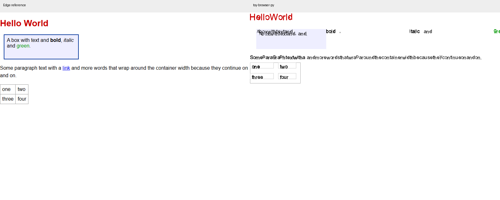

# toy-browser-py 真实浏览器标准复测评估

2026 年 10 月 14 日第二次评估，参照本机 Edge 155.0.4283.45。**原来的 Flex 居中案例已改善，但表格宽度出现回退，安全策略、GUI 脚本执行、DOM 和异步语义等主要阻断项仍存在。项目目前适合教学与受控 HTML 实验，尚未达到通用浏览器的使用标准。**

当前内部测试仍为 925/925 通过。真实浏览器对照表明，内部测试尚未充分覆盖网页兼容性、端到端交互和安全策略。下一阶段应优先修复已经影响页面任务成功率的缺陷。

## 本次范围和评估标准

本次重新运行测试、重新启动真实 Edge、重新生成项目截图和计时，不复用上次运行结果作为本次证据。旧资料保存在 `../20261014/`，本次资料保存在本目录。

| 项目 | 本次范围与判定方式 |
|---|---|
| 环境 | Windows 11、Python 3.12.14、Node 24.21.0、Edge 155.0.4283.45 |
| 项目回归 | 完整 `python test.py`，925 项 |
| JS 与 DOM | 47 个输入，对照执行成功或失败及 console 日志 |
| 布局 | 17 个页面、48 个元素矩形探针，1px 容限 |
| 绘制 | 800×600、设备缩放比 1；基础排版、中文、特殊符号、表单共 4 个页面 |
| HTTP 页面 | 3 个安全策略页、1 个同源外部脚本页，分别由 Edge 和项目 URL 管线加载 |
| 网络基础 | 8 项重定向、gzip、404、资源收集、缓存和策略解析检查 |
| GUI | 真实 tkinter 初始化、更新循环、页面状态、标签页、滚动及内置页面探针 |
| 性能 | 100、1000、5000 个元素，800×600 输出，每项 3 次取中位数 |

GUI 检查由程序驱动，并未完成真实键盘输入、中文输入法、鼠标体验、读屏器和长期稳定性测试。本次以可复现本地页面为主，未完成现代公开网站登录及应用工作流验证，也未运行完整 WPT 或多个浏览器引擎，因此不据此给出网站覆盖率或整体安全认证。

Edge 的矩形是边框盒，项目的内部矩形在含 padding/border 时可能存在盒层次差异；这类比较需结合截图。无 padding/border 的定位与间距错误可直接判断。像素指标对字体和抗锯齿敏感，不能当作浏览器综合得分。

## 与第一次评估相比

| 可比项目 | 第一次 | 本次 | 判断 |
|---|---:|---:|---|
| 内部测试 | 925/925 | 925/925 | 保持通过 |
| 相同 39 个 JS 输入 | 26/39 输出相符 | 26/39 输出相符 | 该样本未改善 |
| 相同 7 个布局案例 | 4/7 全部探针对齐 | 5/7 全部探针对齐 | 原 Flex 居中案例改善 |
| Flex 居中子项 x | 34、114、194 | 22、110、198 | 本次与 Edge 相符 |
| 表格宽度 | 75.12px | 137.14px | Edge 为 70.08px，偏差明显扩大 |
| 三个安全策略页面 | 均与 Edge 不同 | 均与 Edge 不同 | 未解决 |
| GUI 内联脚本、长页面、书签页 | 存在问题 | 仍可复现 | 未解决 |
| 5000 元素到位图 | 约 5.74 秒 | 约 5.64 秒 | 小样本同一量级，不能认定显著提升 |

上次完整同源静态页面的表格高度为 58.4px，本次仍为 58.4px，Edge 为 61px。当前源码中的表格文本收集同时累加 cell 自身文本和 TEXT 子节点，可能重复参与宽度测量；字体族参数也有变化。该原因需进一步剖析，实测已经确认的是宽度回退。

## 本次结果概览

| 维度 | 结果 | 含义 |
|---|---|---|
| 内部回归 | 925/925 | 内部预期一致，不能证明标准兼容 |
| 全部 JS 对照 | 28/47 输出相符 | 包含 1 个双方因无效 JSON 报错的案例；不是语言标准通过率 |
| 新增 8 个 JS 案例 | 2/8 输出相符 | 数组 JSON 和字符串定时器通过，错误语义、身份比较、DOM 删除等失败 |
| 全部布局 | 6/17 页面全部探针对齐，24/48 元素在 1px 内 | 新增边界案例揭示 Flex 和 Grid 缺口 |
| 网络基础 | 8/8 检查通过 | 基础传输与错误处理可运行 |
| HTTP 页面行为 | 4/4 与 Edge 不同 | 安全策略与外部脚本接线是端到端阻断项 |

“相符”包含控制台展示格式，数组显示及 undefined 日志差异不应全部归因于 JS 语义。对于对象身份、错误捕获等新增案例，本次使用简单输出减少格式干扰。测试输入及全部输出可查 `js_cases.json`、双方 `*_js_results.json`。

## 安全策略和外部脚本

| 实际 HTTP 页面 | Edge | 项目 URL 渲染 | 改进重点 |
|---|---|---|---|
| 跨源普通 stylesheet，无 ACAO | 样式生效，背景绿色 | 样式被丢弃，背景白色 | 区分普通加载与允许脚本跨源读取响应 |
| 文档 `style-src 'self'`，跨源资源 ACAO 为 `*` | 样式被阻止 | 样式仍生效 | self 必须依据文档 origin 匹配 |
| 文档 `script-src 'none'`，内联脚本修改文字 | 保持 SAFE | 显示 EXECUTED | 文档 CSP 必须进入脚本执行入口 |
| 同源 `<script src="/external.js">` 修改文字 | 显示 EXECUTED | 保持 SAFE | 下载外部脚本后接入执行和加载时序 |

前三项证明策略实现与真实浏览器不同；第四项证明独立 JS 引擎即使支持某些语法，外部脚本文件也没有贯通至页面行为。内联及外部脚本结果通过实际 PNG 文本核验，背景采样用于样式案例。


实现应使用统一的文档上下文，包括 origin、最终 URL、资源类型、请求 mode、credentials 和文档 CSP。普通资源加载与跨源读取按 [Fetch 请求模式](https://fetch.spec.whatwg.org/#concept-request-mode) 分开处理；CSP 按 [CSP3 的来源匹配规则](https://www.w3.org/TR/CSP3/#match-url-to-source-expression) 在对应入口执行，而不是只过滤资源下载结果。

## Flex 和 Grid 的边界问题

原 Flex 修复仅在本次居中基础案例中对齐。新增测试包括无 padding/border 的反向排列、gap、单子项空间分配和纵向排列，能够排除边框盒比较差异。

| 场景 | Edge | 项目 | 实际影响 |
|---|---|---|---|
| row-reverse + center，三个子项 x | 178、130、82 | 42、-6、-54 | 后两项移到容器外 |
| row-reverse + flex-end，三个子项 x | 100、52、4 | -36、-84、-132 | 全部处于负坐标 |
| gap 10px，三个子项 x | 4、62、120 | 4、52、100 | 忽略主轴间距 |
| 单子项 space-around | x=130 | x=4 | 没有居中 |
| 单子项 space-evenly | x=130 | x=4 | 没有居中 |
| column + center，三个子项 y | 37、65、93 | 45、65、85 | 纵向 margin 未正确计入分配 |
| Grid `1fr 2fr`，gap 10px | 宽约 96.66、193.34 | 两列各 150 | 比例和间距均不正确 |

这些新 Flex 案例还出现交叉轴 margin 偏差，例如 Edge 的 y=4、项目 y=0。带 padding/border 的案例也未对齐，但内部盒坐标契约差异应先统一再统计细节。百分比宽高案例可以对齐，简单等分 Grid 和绝对定位基础案例继续通过。

改进时需统一主轴起点、反向坐标、margin-box 外部尺寸、gap 和单子项规则；不能以修好一张居中页面作为整个 Flex 已兼容的依据。规则和算法可参照 [CSS Flexbox 规范](https://www.w3.org/TR/css-flexbox-1/#justify-content-property)。

## 排版与表单截图



文字重叠、空格处理、段落间距、粗体和斜体行内元素错位仍存在。表格占宽变大；中文和特殊符号能输出图像，但文本质量和布局仍与参照明显不同。表单预填值显示、select 和按钮布局也未改善。

| 页面 | 第一次全图差异 | 本次全图差异 | 本次前景并集差异 |
|---|---:|---:|---:|
| 基础页面 | 5.96% | 6.02% | 77.65% |
| 中文 | 3.36% | 3.36% | 98.38% |
| 特殊符号 | 0.75% | 0.75% | 99.58% |
| 表单 | 2.19% | 2.19% | 99.82% |

计算采用 Pillow 解码，RGB 三通道绝对差之和大于 30 记为差异；两图任一像素任一通道小于 240，纳入前景并集。白背景会稀释全图差异，字体和位移会放大前景差异，因此指标需与截图共同解释。

本次发现旧评估运行器的手写 PNG 解码统计与 Pillow 不一致，已在本次运行器中替换解码并重算数据。正式结论采用 `summary.json` 和最终 `render_diffs.json`；未用错误的中间数字认定产品回退。第一次正式报告的 `summary.json` 本来也使用 Pillow，因此上表可比。

## JS 异步 错误语义与动态 DOM

上次的 Promise 回调顺序、函数形式 setTimeout、事件监听、动态插入后查询、async 和 fetch 返回契约问题仍存在。

新增案例进一步显示：

- `const` 赋值放在 try/catch 内，Edge 输出 caught；项目抛出 Python RuntimeError，未进入 JS catch。
- TDZ 访问放在 try/catch 内，Edge 输出 caught；项目记录 JS error，未按该案例的异常路径执行。
- 未声明标识符访问应抛出 ReferenceError，Edge 被 catch 捕获；项目输出空日志项。
- 两个不同对象分别赋给 a、b，Edge 输出 `true false`，项目输出 `true true`，严格相等缺少正确身份语义。
- removeChild 后再 getElementById，Edge 返回 null，项目仍查到对象，说明查询状态未正确更新。
- 数组 map 后 JSON.stringify 案例输出 `[2,4,6]`，两端相符；字符串形式 setTimeout 也能在排空后输出 timer。

因此不能把“字符串定时器可运行”外推为函数回调或真实事件循环已正确。应建立 JS 可捕获异常类型、对象身份、动态 DOM 查询一致性和任务队列，再接通真实网络 Promise/Response。遇到缺失 API，不能静默地给出看似成功的结果。

## GUI 与日常使用

GUI 启动和标签页新增、关闭可运行，数量变化为 1→2→1。普通页面裁剪滚动能运行。仍存在三个可复现阻断项：

| 场景 | 期望 | 实测 |
|---|---|---|
| GUI 页面内联脚本修改文本 | AFTER | BEFORE |
| 17000px 长页面 | 末尾可访问 | 内容高度截到 16000px，最大偏移 15900px |
| PageInstance 打开 about:bookmarks | 内置页面渲染 | AttributeError：NoneType 无 render_document |

GUI、CLI、本地文件、HTTP 页面应共用一套 Document 和事件状态，使加载、脚本、交互及重排经过同一流程。后续需补真实键盘输入、Tab/Enter、复选框、表单提交、链接历史和中文输入法验收；现有程序探针不能替代这些使用体验测试。

## 性能与稳定性

项目计时在完整内部测试结束后运行，输出固定 800×600 位图；每项 3 次取中位数。Edge 计时包括设置内容、强制布局，另列包含截图的总时间。

| 元素数 | 项目到位图 | 项目含 PNG 输出 | Edge 到强制布局 | Edge 含截图 |
|---|---:|---:|---:|---:|
| 100 | 241ms | 1095ms | 2.7ms | 33.4ms |
| 1000 | 1151ms | 2015ms | 8.6ms | 45.3ms |
| 5000 | 5644ms | 6546ms | 38.3ms | 82.8ms |

两端绘制、编码、进程及 API 开销不同，不计算严格的性能倍数。5000 元素需数秒才能产生项目位图，仍会阻碍交互；PNG 输出另增加约 0.9 秒。建议分阶段记录 style、layout、显示列表、光栅化和编码耗时，减少离屏绘制及全页重建。

本次正常用例和有限重复运行没有出现进程崩溃，但未完成峰值内存、长时间运行、多标签高负载或异常资源压力测试，不能据此声称稳定性达标。

## 改进优先级与验收

| 优先级 | 改进项 | 验收条件 |
|---|---|---|
| P0 | 统一文档策略，修正 CSP self、禁止内联脚本及资源请求模式 | 本次三个安全策略 HTTP 页面全部与 Edge 同行为，扩展不同端口和凭据用例 |
| P0 | 贯通 GUI 和外部脚本，统一 Document 生命周期 | GUI BEFORE 变 AFTER；同源外部脚本变 EXECUTED；加载时序和脚本错误可观察 |
| P0 | 修复基础行内排版，停止表格宽度回退 | 基础页面无重叠和内容飞出；表格尺寸接近 Edge；建立边框盒绘制和内部矩形契约 |
| P1 | 完整修正 Flex 主轴反向、gap、单子项和 margin | 新增 Flex 无边框案例坐标误差 ≤1px；不破坏已对齐的居中案例 |
| P1 | 修正 JS 异常、任务队列、对象身份和动态 DOM | const/TDZ/ReferenceError 可被 catch；对象身份正确；插入、删除后查询一致 |
| P1 | 修复内置页变量覆盖和长页面绘制上限 | bookmarks/history 可开；保留完整文档高度，17000px 页面末尾可访问 |
| P1 | 按模块引入标准测试和端到端任务 | 每次修改保存几何、截图、异步输出和 HTTP 证据；失败预期来自标准，不迁就实现 |
| P2 | Grid 轨道尺寸、真实 fetch、表单输入和文本质量 | `1fr 2fr` 加 gap 正确；同源 API 内容可显示；键盘、IME 和提交工作流通过 |
| P2 | 性能和内存剖析 | 单独测首屏、滚动、局部更新、峰值内存；优化后以同条件多轮数据验收 |

最合理的下一步是先关闭安全策略、GUI/外部脚本和基础排版阻断项，再修 Flex 和 JS 核心语义。增加 API 名称或内部测试数量，无法弥补实际页面行为缺失。浏览器标准验证宜逐步引入 [Web Platform Tests](https://web-platform-tests.org/) 的模块子集，本次最小页面应继续保留为回归。

## 证据与复现

本目录包含本次完整结果，主要文件如下：

- `tests-output.txt`：925/925 完整内部回归输出。
- `comparison.json`：两次样本比较、布局计数及核心源码 SHA256。
- `summary.json`：JS、布局、截图及性能统计。
- `js_cases.json`、`layout_cases.json`、双方结果 JSON：完整输入和参照输出。
- `render_*_comparison.png`：左右截图；`edge_*.png`、`toy_*.png`：HTTP 页面截图。
- `edge_network_e2e.json`、`toy_network_e2e.json`、`toy_net_results.json`：实际 HTTP 与基础网络结果。
- `gui_results.json`、`toy_extra.json`、`edge_perf.json`：GUI 状态及计时原始数据。

从项目根目录运行：

```text
python test.py
python assessments/20261014-retest/expand_cases.py
node assessments/20261014-retest/reference.cjs
python assessments/20261014-retest/toy_js_runner.py
python assessments/20261014-retest/toy_layout_runner.py
python assessments/20261014-retest/toy_render_runner.py
python assessments/20261014-retest/probes.py
python assessments/20261014-retest/gui_probes.py
python assessments/20261014-retest/network_e2e.py
python assessments/20261014-retest/toy_net_runner.py
python assessments/20261014-retest/summarize.py
python assessments/20261014-retest/compare_runs.py
```

评估工具需要 Edge、Playwright 和 Pillow；产品内核仍为标准库实现。脚本中运行时路径需要按其他机器环境调整。本次使用配套 Python 绝对路径，避开系统失效的 python 应用别名。未修改产品源码，也未覆盖第一次正式报告。
