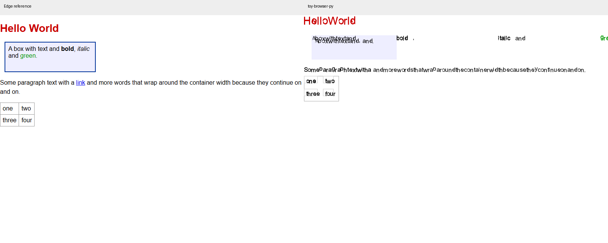
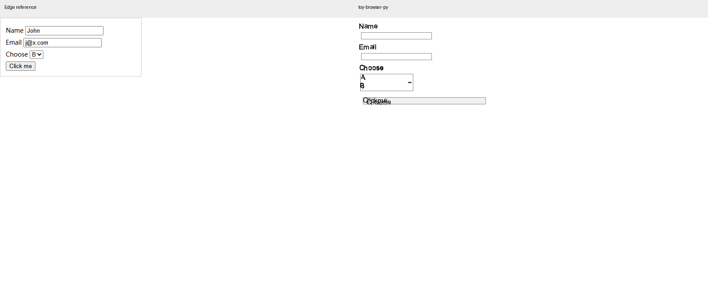

# toy-browser-py 真实浏览器标准实测评估

评估日期：2026 年 10 月 14 日。项目已形成可运行的自研 HTML、CSS、布局、绘制、JS 和网络管线，适合浏览器原理教学与受控页面实验。按照通用浏览器标准，当前仍存在安全策略失效、基础排版错误和 GUI 与脚本管线脱节，尚不适合作为日常浏览器使用。

本次重新执行项目测试，并用本机 Microsoft Edge 155.0.4283.45 对照同一批 HTML 和 JS 输入。**925/925 自测通过，不等于网页兼容性达标。** 实测证据及脚本均保存在本目录；未修改产品源码，未覆盖原有历史评估报告。

## 实测范围与判定方式

- 环境：Windows 11，Python 3.12.14，Node 24.21.0，Edge 无头模式；截图视口 800×600，设备缩放比 1。
- 执行项目 925 条测试、39 个 JS 对照案例、7 个布局案例的 15 个元素矩形探针、4 个截图案例、8 个网络检查，以及 3 个真实 HTTP 页面安全策略对照。
- GUI 使用真实 tkinter 初始化、事件循环更新和程序调用检查页面状态；不冒充人工鼠标、键盘体验测试。
- 布局参照 Edge 的元素边框盒，记录 x、y、width、height，偏差容限 1px。字体和抗锯齿差异需独立分析。
- JS 比较执行成功或失败及日志输出；其中部分日志差异属于控制台展示格式，不能全部视为语言语义错误。补充案例使用简单字符串或 JSON 来减少这个干扰。
- 参照页面使用标准模式 DOCTYPE。部分原有夹具没有 DOCTYPE，若项目要兼容怪异模式，需要另建测试集。
- 本次使用可控本地页面，未执行完整 WPT、多个浏览器引擎、公开网站登录、输入法、读屏器、音视频或长期压力测试。因此不据此声称主流网站兼容或整体安全。

首轮受沙箱套接字及临时目录权限限制，自测为 888/925；解除本机测试所需的运行限制后复测为 925/925。环境导致的假失败不计入项目缺陷。

## 结果概览

| 维度 | 实测结果 | 真实浏览器标准下的判断 |
|---|---|---|
| 项目内部回归 | 925/925 通过 | 内部行为稳定，覆盖标准语义仍不足 |
| JS 原始输出对照 | 26/39 相符 | 包含 1 个双方都因无效 JSON 报错的案例；不能当作标准通过率 |
| 布局 | 4/7 案例全部探针对齐，9/15 元素在 1px 内 | 基础盒模型和 Flex margin 已有确定偏差 |
| 绘制 | 4 个页面均可输出 PNG | 基础页面文字重叠，行内元素错位，表单明显不一致 |
| 网络基础 | 8/8 检查通过 | 重定向、循环检测、gzip、404、缓存等基础路径可用 |
| HTTP 安全策略对照 | 3/3 页面行为与 Edge 不一致 | 存在错误拦截及应拦截而未拦截的问题 |
| GUI | 启动成功，普通页面滚动裁剪可运行 | 脚本执行、长页面上限和内置页面仍有问题，详见下文 |

## 必须优先修正的安全策略

这三项使用本机多个不同端口形成不同 origin，通过真实 HTTP 响应头设置策略，而非只测试策略解析函数。

| 场景 | Edge | 项目 CLI 渲染管线 | 影响 |
|---|---|---|---|
| 普通跨源 `<link rel=stylesheet>`，资源无 ACAO | 样式生效，探针背景为绿色 | 样式被丢弃，探针为白色 | 将普通资源加载与跨源脚本读取混为一谈，容易丢失 CDN 样式 |
| 文档 CSP `style-src 'self'`，跨源样式响应 ACAO 为 `*` | 拦截样式 | 样式仍生效，探针为绿色 | `'self'` 没有正确限制到文档 origin |
| 文档 CSP `script-src 'none'`，内联脚本把 SAFE 改为 EXECUTED | 保持 SAFE | 截图显示 EXECUTED | 文档脚本执行路径没有落实该策略 |

证据：`edge_network_e2e.json`、`toy_network_e2e.json` 和 `edge_*.png`、`toy_*.png`。内联脚本是否执行通过文本截图确认，背景色采样仅用于前两项。

代码中 `net._csp_blocks` 将 `'self'` 当作允许；`HttpResponse.is_policy_allowed` 对所有跨源资源统一要求 ACAO。修正时应建立文档 origin、资源类型、请求 mode、credentials 和文档 CSP 的统一上下文；CSP 必须在相关执行入口生效，不能仅靠下载后过滤。普通资源加载和允许脚本读取响应应按 [Fetch Standard](https://fetch.spec.whatwg.org/) 的请求模式分别处理。

这些是已验证的策略缺陷，不代表本次已完成对整个浏览器的攻击面审计。

## 页面渲染与布局

块布局案例中，带 `box-sizing:border-box`、padding、border、margin 的元素，Edge 边框盒为 `(18,10,200,50)`，项目内部矩形为 `(23,5,190,40)`。内部矩形可能包含盒层次差异，但完整截图也显示边框及内容位置不正确；应统一 content、padding、border、margin 各层坐标契约，并通过绘制边界一起验证。

Flex 容器宽 300px，三个子项各宽 80px、margin 4px、居中。Edge 的 x 为 22、110、198，项目为 34、114、194。分配剩余空间时的外部尺寸与子项推进步长需要修正，不能只验证单个子项宽度。

简单等分 Grid、绝对定位和该相邻外边距折叠案例对齐。表格边框盒约为 Edge 70.08×61、项目 75.12×58.4；字体度量、边框折叠和格子尺寸都可能贡献差异，不能仅凭这一结果断定某个算法是唯一原因。固定高度文本容器矩形对齐，也不能证明文本断行正确。

基础截图中，项目的粗体、斜体、span 被分散到远处，文字重复或重叠，段落空格与断行失真。中文可以绘出真实字形，但字形风格、行高、段落间距和边框与参照有明显差异。表单案例的预填值未显示，select 的显示及按钮宽度、文字重叠与 Edge 不一致。

| 截图案例 | 全图差异像素 | 前景并集内差异像素 |
|---|---:|---:|
| 基础文本与盒模型 | 5.96% | 77.47% |
| 中文 | 3.36% | 98.38% |
| 数学及特殊符号 | 0.75% | 99.58% |
| 表单 | 2.19% | 99.82% |

RGB 通道绝对差总和大于 30 记为差异；两图任一像素任一通道低于 240，纳入前景并集。该指标对位移和字体差异敏感，**不是兼容性评分**。大量白背景会使全图指标看起来很低，必须结合前景指标和截图判断。字体差异也不应掩盖已经可见的文字重叠。

## JavaScript 与 DOM

| 最小场景 | Edge 输出 | 项目输出或行为 |
|---|---|---|
| 同步日志前后加 Promise.then | start、end、promise | start、promise、end |
| 两个函数形式 setTimeout 回调 | sync、early、late | sync，随后函数处理错误日志 |
| 按钮监听并冒泡到 body | button、body | 无日志 |
| innerHTML 插入 span 后 getElementById | new | null |
| createElement 并 appendChild 后查询 | hello | null |
| JSON.stringify 非有限数值及 undefined 数组 | `[null,null,null,0]` | Python ValueError |
| 对象相等及类型转换 | `[true,true,true,true,false]` | `[false,false,true,true,true]` |
| async 函数返回值后 then | 42 | 无日志 |
| fetch 返回值的 then 类型 | function | object |
| XMLHttpRequest、MutationObserver、queueMicrotask、ResizeObserver 类型 | 均为 function | 均为 undefined |

特别注意：原有 `toy_js_runner.py` 没调用项目实际的 `flush_timers`，会把未执行定时器误当作执行完毕。本次副本已修正，并重新生成结果；暴露了函数回调路径的错误。原始定时器案例只观察同步日志，也不足以验证定时器顺序。

39 个案例的 26 个原始输出相符，其中包含一个双方都错误的无效 JSON 输入；排除它后，相符的有效成功案例为 25/38。这个小样本不能代表 ECMAScript 或网站覆盖率。原有数组日志格式与 undefined 显示差异需与语义失败分开统计。

改进应从微任务队列、任务队列、函数回调和错误传播开始。DOM 查询应覆盖动态树或正确维护索引；对象严格相等必须使用身份语义。`fetch` 应返回 Promise 并接通真实请求与 Response，不能用空字符串形成看似可用的 API。事件循环可参照 [HTML Standard](https://html.spec.whatwg.org/multipage/webappapis.html#event-loops)。

## GUI 与入口一致性

`PageInstance.load_html` 默认全页管线直接 parse、style、layout、paint，没有执行与 `browser.render_document` 相同的脚本阶段。最小测试页面的内联脚本应把 BEFORE 改为 AFTER，GUI 页面状态仍保持 BEFORE。这比单独 JS 引擎支持多少语法更直接影响实际浏览器体验。

普通 2000px 页面在 400×200 视口下可滚动到 1800px，得到 400×200 裁剪位图。全页管线又将内容高度硬截到 16000px，应改为保留完整文档高度、按视口或分块绘制，否则超长页面末尾无法访问。

内置 bookmarks/history 路径中，`_about_page` 将导入的 browser 模块名覆盖为拥有该页面的 TabBrowser 对象或 None，随后调用 `browser.render_document`，会造成 AttributeError。程序驱动探针记录于 `gui_results.json`，需把模块别名和窗口对象名分开。

源码检查还显示，点击与 Enter 的激活路径主要更新焦点、复选框和导航，未形成统一 JS 事件分派；文本输入只设置 active_form_field，未见通用键盘输入绑定接通 `_set_form_value`。这些属于入口审查发现，不能表述为已完成输入法和人工键盘测试。

## 性能

800×600 视口，100、1000、5000 个固定尺寸 div，各重复 3 次取中位数。最终项目样本在内部测试结束后运行；仍属于当前机器的小样本，不是隔离硬件基准。

| 元素数量 | 项目渲染到位图 | 项目含 PNG 写出 | Edge 设置内容并强制布局 | Edge 含截图 |
|---|---:|---:|---:|---:|
| 100 | 257ms | 1203ms | 3.1ms | 30.4ms |
| 1000 | 1222ms | 2126ms | 9.8ms | 43.7ms |
| 5000 | 5744ms | 6634ms | 44.7ms | 77.7ms |

两端 API、绘制时机、编码及进程开销不同，不能用相除得到严格的“慢多少倍”。但项目在 5000 元素时约 5.7 秒才能产生位图，已明显不适合交互刷新。PNG 输出还增加约 0.9 秒，应分别剖析 style、layout、display list、rasterize、编码，优先处理离屏绘制、重复样式匹配及 Python 像素循环。

GUI 全页绘制比此处固定视口测试更容易增加时间和内存；需单独测首屏、滚动、局部交互更新，而不是把 CLI 导出性能当作 GUI 帧率。

## 改进顺序与验收条件

| 优先级 | 具体改进 | 可检查的验收条件 |
|---|---|---|
| P0 | 统一文档安全上下文，修正 CSP self、脚本执行检查、资源请求模式 | 本次 3 个 HTTP 页面对照行为全部与 Edge 一致；增加跨端口、跨协议及凭据案例 |
| P0 | GUI 与 CLI 共用 DOM、脚本、事件循环、布局和资源状态 | 同一 BEFORE/AFTER 页面两端均为 AFTER；真实 GUI 点击触发监听，输入和提交接通同一管线 |
| P0 | 修复行内格式化、空白折叠、盒坐标契约和 Flex 外部尺寸 | 基础截图消除重叠及内容飞出；几何用例全部 ≤1px；字体差异单独建立容限 |
| P1 | 修正微任务、函数定时器、DOM 动态查询、对象身份及 JSON 数值 | 本次 10 个补充 JS 案例按语义达标，定时器异步输出可验证，禁止静默成功 |
| P1 | 接通真实 fetch Promise/Response，明确缺失 API | 同源 JSON 请求可显示结果；跨源读取遵守策略；失败拒绝 Promise，并有可见错误 |
| P1 | 修复内置页面模块名覆盖及 16000px 截断 | history/bookmarks 打开不抛异常；17000px 文档末尾能通过滚动访问 |
| P1 | 接入持续对照测试和性能剖析 | CI 保存 Edge 版本、输入、DOM/几何/截图/异步输出；记录分阶段耗时与内存 |
| P2 | 扩展 Grid、字体、表单、响应式和可访问性 | 按模块引入 WPT 子集及页面验收任务；增加窄屏、IME、键盘导航和读屏器验证 |

建议先用两轮里程碑稳定基础：第一轮关闭安全策略、GUI 脚本、基础排版三个阻断项；第二轮完善 DOM、异步任务、网络 API、表单输入和长页面。之后再扩展高级 CSS、媒体及浏览器周边功能。未给出工期，实际工作量取决于是否保留纯 Python 自研 JS 与渲染约束。

教学目标可继续坚持自研内核；若目标是支持现代网站，应单独评估接入成熟 JS 引擎或浏览器内核的路线。不要用更多模拟 API 和内部自测数量替代真实任务成功率。

跨浏览器标准验证建议采用 [Web Platform Tests](https://web-platform-tests.org/) 的模块子集，并保留本次端到端最小页面作为回归。项目原有测试应继续保留，但应增加从标准预期出发的案例，而不是让预期迁就现有实现。

## 证据与复现

- `tests-output.txt`：925/925 的本次完整输出；`toy_net_results.json`：8 项网络检查。
- `reference.cjs`：本次 Edge 对照运行器；`environment.json`：浏览器版本和视口。
- `js_cases.json`、`toy_js_runner.py`、双方 `*_js_results.json`：39 项 JS 输入与输出。
- `layout_cases.json`、双方 `*_layout_results.json`：布局输入和矩形数据。
- `render_*_comparison.png`、双方 `*_shot_*.png`：截图及左右对比。
- `network_e2e.py`、`network_reference.cjs`：HTTP 安全策略完整页面测试。
- `probes.py`、`toy_extra.json`、`edge_perf.json`：性能、启动、普通滚动原始数据。
- `gui_probes.py`、`gui_results.json`：GUI 脚本、长页面及内置页面探针。
- `summarize.py`、`summary.json`：对照统计。运行器需要本机已安装 Edge，以及 Playwright/Pillow；产品本身仍使用标准库。

运行顺序：项目根目录执行 `python test.py`；执行 `python assessments/20261014/probes.py` 更新补充输入，再运行 `node assessments/20261014/reference.cjs`、`python assessments/20261014/toy_js_runner.py`、`python assessments/20261014/toy_layout_runner.py`、`python assessments/20261014/toy_render_runner.py`、`python assessments/20261014/summarize.py`。网络与 GUI 探针分别运行 `network_e2e.py` 和 `gui_probes.py`。本环境默认 python 是失效的 Windows 应用别名，实际测试使用 Codex 配套 Python 绝对路径；脚本中的运行时路径需在其他机器调整。
