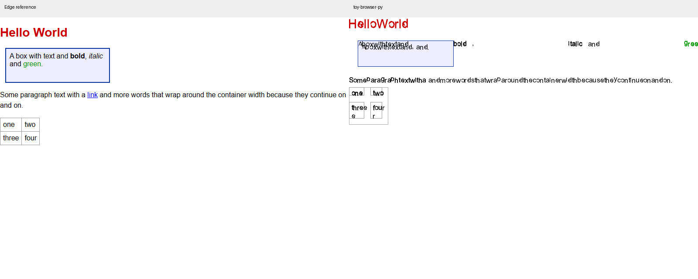

# toy-browser-py 第三轮实测评估

评估日期：2026 年 10 月 15 日。当前基于提交 `e2a0d3b`，参照真实 Microsoft Edge 155.0.4283.45。

**当前版本已修复若干上轮问题，但尚未达到通用浏览器可用标准。** CLI 的 CSP self、禁止内联脚本和同源外部脚本基础案例已通过；GUI 本地内联脚本、长页面和书签页面也有改善。主要阻断项转为：GUI HTTP 页面丢失脚本修改、点击事件未贯通、脚本时序与重复执行错误，以及基础排版和异步语义缺口。

本次重新运行项目与 Edge，结果单独保存在本目录；未修改产品源码，未覆盖前两轮证据。

## 实测范围与判定边界

| 项目 | 范围 |
|---|---|
| 运行环境 | Windows 11，配套 Python 3.12.14，Node 24.21.0，Edge 155.0.4283.45 |
| 内部回归 | `python test.py`，925 项 |
| JS 与 DOM | 与上轮相同的 47 个输入，重新记录执行结果、日志和定时器排空异常 |
| 布局 | 相同 17 个页面、48 个内部矩形探针；另补 4 个无文字色块绘制边界检查 |
| 截图 | 800×600、缩放比 1；基础排版、中文、特殊符号、表单共 4 个页面 |
| HTTP 页面 | 上轮 4 个页面，另加混合脚本顺序、合法 CSP nonce、重复外部脚本，共 7 个 |
| 网络基础 | 8 项重定向、循环检测、gzip、404、资源收集、缓存及策略解析检查 |
| GUI | tkinter 初始化、更新循环、页面状态、长页面、标签页、导航历史与点击处理入口 |
| 性能 | 100、1000、5000 个元素，固定 800×600 位图，每项重复 3 次取中位数 |

本次采用可复现本地页面，不代表公开现代网站兼容率。没有完成全量 WPT、多个浏览器引擎、真实键盘和中文输入法、读屏器、音视频或长期内存压力验证。GUI 为程序驱动的实际处理入口检查，未冒充人工使用体验。

内部矩形和 Edge 边框盒定义并不完全一致，因此几何原始统计只用于跟踪，不能直接当作 CSS 标准通过率。含 padding/border 的案例需结合真实绘制边界判断；本次补充色块截图就是为排除这一干扰。

## 关键结果与上轮比较

| 项目 | 10 月 14 日复测 | 本次 | 判断 |
|---|---|---|---|
| 内部回归 | 925/925 | 925/925 | 继续通过 |
| 相同 47 个 JS 原始输出 | 28 个相符 | 33 个相符 | 有改善，含无效 JSON 和定时器统计干扰，不能作为兼容率 |
| 17 个页面的内部矩形全部对齐 | 6 个 | 7 个 | 原始探针统计，含盒定义差异 |
| 48 个内部矩形在 1px 内 | 24 个 | 26 个 | 同上，不作产品综合评分 |
| CLI 上轮 4 个 HTTP 页面 | 0 个与 Edge 同行为 | 3 个同行为 | self、禁止内联、同源外部脚本改善；跨源样式仍失败 |
| GUI 本地内联脚本 | BEFORE | AFTER | 已改善 |
| GUI 17000px 页面 | 截到 16000px | 内容高 17020px，可滚至偏移 16920px | 已改善 |
| GUI 书签页 | AttributeError | 正常打开 | 已改善 |
| CLI 表格宽度 | 137.14px | 73.12px，Edge 70.08px | 明显接近，但表格排版仍不正确 |
| 5000 元素生成位图 | 约 5.64 秒 | 约 5.84 秒 | 同一量级；小样本不能认定显著退化或提升 |

新增确认的 JS 改善包括 const 赋值和 TDZ 错误能进入 catch、不同对象身份比较正确、createElement 后的查询可以找到新增元素。原始相符数增加中还有一个定时器案例只观察同步日志；本次记录到其定时器回调异常，因此不能把它当作定时器已经修复。

## 页面脚本仍未贯通所有入口

同一 HTTP 输入分别经过 Edge、项目 CLI URL 渲染和 GUI PageInstance.load_url。CLI 文本由 execute_all 返回后的 DOM 观察获得，并用截图复核；观察器仅记录结果，不改变脚本执行。

| 实际页面 | Edge | 项目 CLI | 项目 GUI |
|---|---|---|---|
| 同源外部脚本将文字改为 EXECUTED | EXECUTED | EXECUTED | SAFE |
| 外部脚本后接普通内联脚本 | SAFE\|EXTERNAL\|INLINE | SAFE\|INLINE\|EXTERNAL | SAFE |
| 同一外部脚本标签出现两次 | SAFE\|EXTERNAL\|EXTERNAL | SAFE\|EXTERNAL | SAFE |
| CSP 允许 nonce=good 的内联脚本 | EXECUTED | SAFE | SAFE |

CLI 基础外部脚本已执行，不能再沿用上轮“外部脚本一概不执行”的结论。但新增页面证明，内联脚本先统一执行、外部脚本后统一执行的方式破坏了普通脚本的文档顺序；按资源 URL 聚合脚本还会丢失重复标签的执行次数。资源下载缓存可以复用响应，脚本元素的执行次数必须独立管理。处理模型参照 [HTML script 元素标准](https://html.spec.whatwg.org/multipage/scripting.html#the-script-element)。

GUI 的 URL 路径先在一个 DOM 上执行脚本，随后调用 load_html 重新解析原始 HTML 且 run_scripts=False，最终显示树丢失了脚本修改。这解释了本地 HTML 已显示 AFTER，而 HTTP 页面仍显示 SAFE。应复用同一个 Document、Host 和 DOM，不应把修改后的状态再还原为源 HTML。

## 安全策略的修复与剩余差距

| 实际 HTTP 策略 | Edge | 本次 CLI | 判断 |
|---|---|---|---|
| `style-src 'self'`，跨源样式带 ACAO `*` | 样式被阻止 | 样式被阻止 | 基础来源匹配已修复 |
| `script-src 'none'`，内联脚本修改文字 | SAFE | SAFE | 本次基础禁止案例已修复 |
| 普通跨源 stylesheet，没有 ACAO | 绿色背景，样式生效 | 白色背景，样式被丢弃 | 仍错误地要求普通样式资源满足 CORS 读取条件 |
| `script-src 'nonce-good'`，脚本 nonce=good | EXECUTED | SAFE | 合法 nonce 未被正确支持 |

请求应区分普通加载、跨源脚本读取及凭据模式，按 [Fetch 请求模式](https://fetch.spec.whatwg.org/#concept-request-mode) 处理。CSP 还需按脚本元素执行 [nonce 与来源列表匹配](https://www.w3.org/TR/CSP3/#match-nonce-to-source-list)，不能仅靠全局 unsafe-inline 开关。

GUI HTTP 页面普遍丢失脚本修改，因此它显示 SAFE 并不能独立证明 CSP 已正确执行。本次只确认 CLI 的两个基础禁止案例行为正确，不将其外推为整个产品已通过安全审计。

## GUI 点击与导航任务

通过 TabBrowser._open_url、_back、_forward 的真实导航处理入口，about:version → about:bookmarks 的后退、前进分别回到正确页面。上轮 PageInstance.load_url 探针没有通过负责维护历史栈的 UI 导航入口，不能把它后退无变化直接判为 GUI 导航缺陷；本次已补正验证方式。

按钮点击则仍未形成有效页面任务：

- 相同 HTML 在 Edge 真实点击后，输出由 SAFE 变为 CLICKED。
- GUI 的布局命中明确为按钮 `id=b`，调用实际 `_click_dispatch` 后仍为 SAFE。
- 标签页数量 1→2→1、GUI 本地脚本以及长页面滚动检查可以通过。

因此“页面脚本初次执行”与“用户操作触发脚本”需要分开验收。下一步应将点击、Enter、input、change 和表单提交接到同一事件分派及状态更新流程，并验证重排不会清除既有 DOM 状态。

## 布局修复仍有边界错误

反向 Flex 的主轴 x 已与 Edge 对齐：center 为 178、130、82，flex-end 为 100、52、4。gap 10px 案例的 x 也已对齐为 4、62、120。单子项 space-around 和 space-evenly 均已居中到 x=130，column 居中为 y=37、65、93。非等宽 Grid 的两列约为 96.67、193.33px，与 Edge 接近。

但交叉轴 margin 和 padding/border 组合仍错误。以下是直接从 PNG 中测得的红色区域联合边界，格式为左、上、右、下，右下为开区间：

| 页面 | Edge 红色边界 | 项目红色边界 | 含义 |
|---|---|---|---|
| 反向 Flex 居中 | 82,4,218,24 | 82,0,218,20 | 水平修好，整体仍上移 4px |
| Flex gap | 4,4,160,24 | 4,0,160,20 | 间距修好，交叉轴 margin 仍缺失 |
| 非等宽 Grid | 0,0,300,20 | 0,0,300,20 | 联合边界吻合，列宽另有矩形数据支持 |
| Flex 含 padding/border | 63,6,237,36 | 82,6,244,24 | 仍存在真实绘制尺寸和位置错误 |

这些结果排除了单纯内容盒与边框盒命名不同的解释。对于原等分 Grid 中内部宽 98px 对 Edge 边框盒 100px 的差异，本次没有单凭这一数字宣称回退。

## 基础排版与表单

表格宽度已接近参照，但文字仍重叠、断行不当；粗体、斜体和 span 行内元素仍分散到容器远处，段落空格和行高不正确。盒子边框现在能绘制出来，但其尺寸和文字排列仍与参照不同。

| 截图页面 | 上轮全图差异 | 本次全图差异 | 本次前景并集差异 |
|---|---:|---:|---:|
| 基础页面 | 6.02% | 6.26% | 81.14% |
| 中文 | 3.36% | 3.42% | 98.40% |
| 特殊符号 | 0.75% | 0.75% | 99.58% |
| 表单 | 2.19% | 2.38% | 99.81% |

Pillow 解码后，RGB 通道绝对差总和大于 30 记为差异；两图任一像素任一通道低于 240 纳入前景并集。该指标对字体、抗锯齿和位置敏感，不是兼容性分数。数值未体现整体视觉改善，截图中的重叠与内容错位仍属于确定的可用性问题。

## JavaScript 与 DOM 剩余问题

本轮实际改善：const/TDZ 的 catch 路径、对象身份比较和新建节点查询。仍可复现：

| 场景 | Edge | 项目 |
|---|---|---|
| Promise 与同步日志顺序 | start、end、promise | start、promise、end |
| 两个函数形式 setTimeout | sync、early、late | sync，排空时出现 TypeError |
| 按钮监听并冒泡 | button、body | 无日志 |
| innerHTML 插入后查询 | new | null |
| removeChild 后查询 | true，表示已找不到 | false，仍被查询到 |
| 未声明标识符放入 try/catch | caught | 空日志项，没有按预期抛错 |
| JSON.stringify 非有限数值数组 | `[null,null,null,0]` | Python ValueError |
| async 返回值 then | 42 | 无日志 |
| fetch 返回值的 then 类型 | function | object |

原始 33/47 相符包含 1 个双方都因无效 JSON 失败的输入，以及 1 个同步日志相符但定时器排空失败的案例。旧运行器会吞掉排空异常，本次在 `drain_error` 字段记录，两个案例出现函数处理 TypeError。不能把原始相符率直接作为标准通过率，也不能只根据 status=OK 判断异步功能成功。

## 性能

完整回归测试结束后运行项目计时，每项 3 次取中位数，视口固定 800×600：

| 元素数 | 项目生成位图 | 项目含 PNG 输出 | Edge 设置内容并强制布局 | Edge 含截图 |
|---|---:|---:|---:|---:|
| 100 | 247ms | 1103ms | 2.5ms | 33.7ms |
| 1000 | 1207ms | 2079ms | 9.5ms | 44.9ms |
| 5000 | 5842ms | 6721ms | 50.1ms | 78.1ms |

两端 API、绘制、编码及进程开销不同，不计算严格倍数。项目 5000 元素仍需约 5.8 秒产生位图，PNG 另增加约 0.9 秒，尚不适合频繁交互重绘。应分阶段剖析样式、布局、显示列表、光栅化和编码，并测 GUI 局部更新及滚动，不能只优化独立布局探针。

本次有限正常用例未发生进程崩溃；没有开展长期负载及峰值内存验证。长页面上限移除后，应补测大文档内存和绘制策略，再判断扩展能力。

## 改进顺序与验收条件

| 优先级 | 具体工作 | 验收条件 |
|---|---|---|
| P0 | GUI HTTP 加载复用已经执行脚本的 Document 和 Host | 同源外部脚本在 CLI 和 GUI 均显示 EXECUTED，重排后状态不丢失 |
| P0 | 接通 GUI 点击及默认动作 | 本次命中按钮的点击任务显示 CLICKED；后续验证输入、复选框和表单提交 |
| P0 | 按脚本元素维护执行顺序与次数 | 混合脚本顺序为 EXTERNAL→INLINE；同一外部 src 标签两次必须执行两次 |
| P1 | 修正资源请求模式与 CSP nonce | 无 ACAO 的普通跨源样式正常生效；合法 nonce 允许、不匹配 nonce 阻止；保留已通过禁止案例 |
| P1 | 修复行内格式化和盒模型绘制 | 消除基础页重叠、内容飞出和表格异常断行；统一内容盒、边框盒及命中区域契约 |
| P1 | 补全 Flex 交叉轴及 padding/border 组合 | 无文字几何案例的位置和尺寸在 1px 内，不能只验主轴 x |
| P1 | 修复微任务、函数定时器和 DOM 索引一致性 | 排空无异常；Promise 在同步代码后执行；插入、删除后查询一致 |
| P2 | 真实 fetch/Response、表单及可访问性任务 | 同源 JSON 结果可显示；键盘、IME、提交及读屏器以实际任务验收 |
| P2 | 性能和大文档内存治理 | 同条件多轮测首屏、滚动、局部更新和峰值内存，依据剖析结果优化 |

建议先把 CLI、GUI、HTTP 加载和用户事件统一为一套状态流程，再继续扩展功能表。当前最有价值的验收单位是“同一页面经过加载和交互后达到与 Edge 相同的结果”。内部测试保留，但应加入本轮完整页面作为回归，并逐步接入 WPT 模块子集。

## 证据和复现

- `tests-output.txt`：925/925 本轮完整回归。
- `environment.json`、`comparison.json`：Edge 版本、对比统计及核心源码 SHA256。
- `summary.json`、`render_diffs.json`、`render_*_comparison.png`：本轮统计与截图。
- `edge_js_results.json`、`toy_js_results.json`：47 个 JS 输入结果及 drain_error。
- `edge_layout_results.json`、`toy_layout_results.json`、`painted_geometry.json`：内部几何和实际色块边界。
- `edge_network_e2e.json`、`toy_network_e2e.json`：7 个 HTTP 页面，分别记录 CLI DOM 文字、GUI DOM 文字及 CLI 色块采样。
- `gui_results.json`：本地脚本、长页面和标签页；`gui_workflow.json`、`edge_gui_workflow.json`：通过真实入口的导航及按钮点击。
- `toy_extra.json`、`edge_perf.json`：三轮计时原始数据；`toy_net_results.json`：基础网络检查。

从项目根目录复现：先运行 `python test.py` 和 `node assessments/20261015/reference.cjs`；再运行本目录的 `toy_js_runner.py`、`toy_layout_runner.py`、`toy_render_runner.py`、`probes.py`、`gui_probes.py`、`gui_workflow.py`、`network_e2e.py`、`toy_net_runner.py`。点击参照运行 `node assessments/20261015/gui_reference.cjs`；色块边界依次运行 `geometry_reference.cjs` 和 `geometry_pixels.py`；最后运行 `summarize.py` 与 `compare_runs.py`。

评估工具依赖 Edge、Playwright 和 Pillow；内核仍为标准库实现。脚本中的配套运行时路径需按其他机器调整。当前机器使用配套 Python 的绝对路径，避免失效的系统应用别名。本次仅新增评估目录，产品源码未改动。
