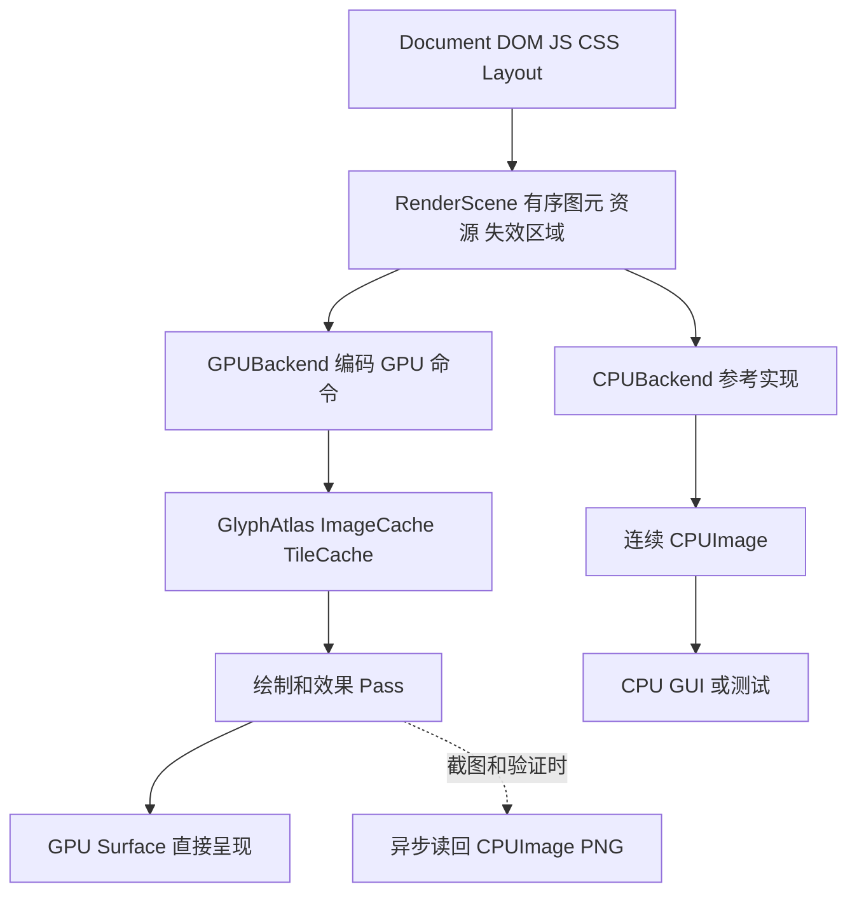

# toy-browser-py GPU 光栅化迁移方案

> **⚠️ 未实施（历史建议）**：本方案为 2026-10-16 第五轮的 GPU 迁移建议（P01–P13），截至批次 41 **尚未实施**；第六轮按"纯逻辑核心 + CPU 后端"路线推进，GPU 后端与可选 wgpu 依赖留待后续批次。本文作为历史架构建议保留，不表示已落地。

本方案依据 2026 年 10 月 16 日第五轮实测，是待实施的架构建议。本次只查询到 RTX 3060 Ti 与驱动信息，未创建设备、未安装 GPU 软件栈、未测得 GPU 帧率或加速倍数。

**建议保留当前纯标准库 CPU 后端作为默认和参考，新增可选 wgpu-py 后端，并配套可直接呈现 GPU surface 的 GUI。先统一像素缓冲区、显示列表和窗口呈现，再逐步把几何、文字 mask、图像和效果迁到 GPU。**

## 先明确当前瓶颈

5000 元素代表样本：

| 阶段 | 实测 |
|---|---:|
| HTML 解析 | 176ms |
| 样式 | 1076ms |
| 布局 | 3319ms |
| 构建显示列表 | 1336ms |
| CPU 光栅化 | 151ms |
| 到位图总计 | 6058ms |
| PNG 内存编码 | 571ms，另计 |

光栅化占 2.49%。若只将这一段降至零，其他阶段不变，理论加速上限为 `1/(1-0.02494)≈1.026`。这只是当前简单、主要内容在视口外的长页面样本；阴影、图像、高 DPI 或动画场景可能有不同占比，需要单独测。

GUI 800×600 位图转 PhotoImage 的中位约 1209ms。实际近期优先级应为：布局/命令构建优化、连续缓冲区与直出呈现、GUI 非阻塞，然后再把 GPU 光栅化变为持续收益。GPU 不能替代 JS、CSS、布局和文字排版的正确实现。

## 推荐技术路线

| 路线 | 适用范围 | 本项目判断 |
|---|---|---|
| wgpu-py + rendercanvas + 可选 PySide6 外壳 | Python 控制显式 GPU 资源，跨平台渲染后端 | 推荐作为可选加速版，主逻辑仍保留 Python |
| Qt Quick 原生场景图/QRhi | 长期将 GUI 和渲染一起迁向 Qt | 可选长期路线，复杂底层扩展可能需要 C++，避免再同时维护另一套跨 API 互操作 |
| Windows Direct2D/DirectWrite | Windows 专用绘制与文字 | 若明确只做 Windows 可评估；COM、DPI、设备恢复和字体一致性维护成本较高 |

[wgpu-py 官方指南](https://wgpu-py.readthedocs.io/en/stable/guide.html) 提供 Python GPU 资源、命令提交与画布接口；其原生实现可使用 Vulkan、Metal、D3D12 等后端。本机 Windows 原型可先验证 D3D12，再按驱动测试 Vulkan，不根据显卡名称保证任何后端可用。

研究时文档版本为 wgpu-py 0.32.0、rendercanvas 2.7.2。实施时固定经过验证的版本和对应示例标签，不能使用最新主分支示例假定安装版本兼容。[安装文档](https://wgpu-py.readthedocs.io/en/stable/start.html) 说明 wheel 包含原生二进制，这将成为可选分发依赖。

项目 CONTRIBUTING 当前要求纯标准库，因此建议默认 `cpu` 模式继续遵守，`gpu` 模式单独声明依赖和发布包。此建议不等于已经修改了仓库约束。若必须所有模式都仅标准库，Windows ctypes 系统 API 是另一条路线，但工作量和可维护性需重新评估。

## 分清呈现 合成与光栅化

1. **GPU 呈现**：CPU 已生成整张图，只上传纹理显示。它可以减少窗口转换开销，尚未迁移 CPU 光栅化。
2. **GPU 合成**：把已有图层纹理在 GPU 上滚动、变换、裁剪、混合，减少重复绘制。
3. **GPU 光栅化**：矩形、圆角、边框、文字 quad、图像等显示命令由 GPU 生成最终像素。

三个阶段应分别计时和验收。若每帧先 GPU 绘制、再读回 CPU、转换 PPM、交给 Tk PhotoImage，仍保留本次测得的主要 GUI 成本。

800×600 RGBA8 一帧约 1.83MiB，1080p 约 7.91MiB，3840×2160 约 31.64MiB。多重帧缓冲、临时图层、回读和 CPU/GPU 往返会放大带宽及内存消耗。交互路径应直接 present，截图与 PNG 导出才异步回读。

## 建议架构



保留 HTML、CSS、布局和网络职责。渲染后端接收已经通过文档策略的资源，不自行抓取 URL，也不执行 JS。

建议接口，尚未加入源码：

```text
RenderBackend.render(scene, viewport, damage) -> FrameHandle
RenderBackend.present(frame, surface)
RenderBackend.snapshot(frame) -> CPUImage
RenderBackend.release_document(document_id)
```

FrameHandle 可以是 GPU texture 或 CPU buffer，不能把每个 GPU render 的返回值强制要求为 Bitmap，否则每帧都会隐含一次读回。Viewport 必须携带 CSS 尺寸、物理尺寸、DPR、页面缩放和滚动偏移；Frame 必须携带文档版本以丢弃过期结果。

建议新增 renderer/contracts、renderer/cpu_backend、renderer/wgpu_backend、renderer/resource_cache、renderer/tile_cache、gui_qt 等模块，作为后续重构目标。现在不需要为一个后端复制一套 DOM、布局和会话逻辑。

## 第一阶段 统一 CPU 数据与显示契约

当前 Bitmap 是 Python int 列表，像素为 0xRRGGBB，临时图层缺少完整 alpha 表达。应先定义连续 CPUImage：宽、高、stride、显式通道次序、alpha 约定、色空间与 buffer。保留旧 Bitmap API 的适配层，避免一轮迁移破坏所有测试。

wgpu-py 可以接收 bytes、bytearray、memoryview 等 buffer-protocol 对象，不必为 GPU 强制引入 NumPy。上传数据应批量打包，避免每图元、每像素经 Python 调用一次。

当前 DisplayCommand 同时携带多种形状的字段，仍可作为过渡输入。逐步将绘制 IR 明确为：

- FillRect、RoundedRect、Border、ImageQuad、GlyphRun、Gradient。
- PushClip/PopClip，必要时 PushLayer/PopLayer，明确 transform 和隔离图层。
- 资源 ID、bounds、paint order、document version 和 damage。

文字位置应在共享的 CPU 文本准备阶段确定，形成 glyph run；不能让 GPU 后端重新自行换行或采用不同字体度量。CPU 与 GPU 使用同一几何和资源数据。

验收：不改变已有正确几何；消除 GUI 逐像素 PPM 打包；保留 CPU 导出；对 alpha、stride、通道次序和 DPR 建立小图测试。

## 第二阶段 打通 GPU surface

先用已存在的 CPU 图像上传纹理，验证窗口、缩放、resize、最小化恢复和截图；此阶段明确标记为 GPU 呈现原型。随后接入真正 GPU 图元绘制。

推荐在可选 PySide6 Widgets 中嵌入 rendercanvas.qt.QRenderWidget。官方文档说明 Qt 后端默认使用 bitmap 呈现；要获得交互 GPU 路径，应测试 `present_method="screen"`，确认没有隐式 CPU 回读，并处理弹出控件、遮挡和颜色管理差异。[Qt 后端说明](https://rendercanvas.readthedocs.io/stable/backends.html#support-for-qt)

Tk 版本保留为 CPU 版；不建议在第一版同时承担 Tk 子 HWND、GPU surface、跨平台输入法和窗口生命周期适配。

若改走 Qt Quick，应沿其原生场景图/QRhi 集成，而不是随意共享不同 API 的纹理或设备。Qt 的 GPU 操作和场景图有严格渲染线程边界，需遵守 [Qt Scene Graph 文档](https://doc.qt.io/qt-6/qtquick-visualcanvas-scenegraph.html)。

验收：常规交互无每帧 snapshot/读回；UI 显示 adapter、backend 和 fallback 状态；画布 resize 不崩溃；保留 CPU 模式。

## 第三阶段 真正 GPU 光栅化

| 当前命令 | GPU 实现建议 | 首版范围 |
|---|---|---|
| rect / border | 实例化 quad，几何/颜色放批量 buffer | 优先实现 |
| rounded | 圆角距离覆盖或等价几何，明确抗锯齿 | 与 CPU 边缘建立容差 |
| gradient | 片元插值，采用统一颜色规则 | 先支持现有线性渐变 |
| img | CPU 解码、缓存 texture，quad 采样 | 统一透明度和缩放滤波 |
| text | CPU 字体/回退/字形 mask，R8 atlas + GPU quad | 首版保留现有字体解析和字形光栅化 |
| shadow / blur | 独立中间纹理，横纵两次滤波 | 在基础路径稳定后实现 |
| clip / transform / opacity | scissor、mask/stencil、变换、离屏组混合 | 不能只按单个图元透明度替代组透明度 |

首版文字是“CPU 字形 mask + GPU 像素混合”，不是声称已实现 GPU 字体轮廓光栅化。字形 atlas 键至少包括 face、glyph、尺寸、DPR、粗细/样式；采用有上限的 LRU 和按需上传，不能每帧重新生成整张 atlas。

矩形和图像批处理只能合并视觉顺序等价的相邻命令。半透明内容、重叠、阴影与隔离组不能为了减少 draw call 而随意跨层排序。

颜色契约必须先确定。当前 CPU 在编码后的 RGB 数值上近似混合，GPU 默认 sRGB 转换和混合可能产生不同结果；迁移时显式约定输入、工作空间、预乘 alpha 和输出转换。若改为更正确的线性混合，应同时更新 CPU 参考和版本化金图，不能把所有差异归咎于 GPU 精度。

CPU 回退只能在保持裁剪和混合顺序的完整子树/隔离层边界使用，不能在复杂叠放中随意混入一张不带正确 alpha 的 RGB 图。回退层必须缓存，避免每帧重新 CPU 渲染和上传。

验收：矩形、图像、裁剪、文字、透明组和效果的测试页对照 CPU；文字边缘单独设置容差；测试两张重叠半透明矩形、嵌套裁剪、变换后命中和高 DPI。

## 第四阶段 分块与增量合成

长页面只保留逻辑内容高度，不生成与整页等高的 GPU 或 CPU 大位图。建议先用 512×512 物理像素 tile，按可见区与小范围预取；tile 大小后续用实测调整。

滚动主要调整可见 tile 与合成偏移，只为新暴露区域绘制。DOM、样式、布局和图片变化生成 damage；不要每帧把 GPU 图读回，用逐像素 changed_region 才判断哪里变化。

缓存分为 glyph atlas、image、tile 和临时效果层。可从 128MiB 资源缓存与受配置约束的总预算起步，帧缓冲和临时图层也计入总量；超预算先减少预取和缓存，再降低效果或回退。WMI AdapterRAM 字段不能作为可靠的可用显存预算。

GPU 资源由一个明确的设备/提交所有者管理；使用有界帧队列。设备错误、驱动重置、分配失败或 surface 不可用时，重建资源或回退 CPU，并在诊断面板解释原因。wgpu-py 的 API 与浏览器 WebGPU 并不完全相同，具体错误与设备恢复接口需按固定版本验证。

## 基准与上线条件

至少建立三组不同负载：

1. 当前 5000 元素长页面：观察布局和命令构建是否仍主导，不能只报 GPU shader 时间。
2. 高 DPI、多个图像、圆角、阴影、透明组的绘制重页面：冷启动、热缓存、滚动和效果更新分别计时。
3. 真实 GUI 任务：导航期间输入、连续滚动、resize、切标签、截图导出和设备恢复。

记录 CPU 准备、buffer/texture 上传、GPU 执行、present 等待、UI 响应、GPU/CPU 内存和必要的回读成本。GPU 时间可用该设备支持的时间戳能力，不能把异步 queue submit 的 CPU 返回时间当作 GPU 绘制时间。

建议目标为：目标机器热缓存滚动 p95 帧时间接近或低于 16.7ms，UI 调度 p95 小于 50ms；这些是待验证的目标，不是性能承诺。先收集足够样本，再谈 p95。软件适配器、无 GPU 和远程环境可降级。

只有当 CPU/GPU 正确性、实际 GUI 呈现、GPU-heavy 负载及整端体验同时改善，才把 GPU 作为可推荐模式。首轮交付可只包含基础 GPU 后端、直接呈现和文字 atlas；复杂滤镜和 GPU 字形轮廓留到后续。

## 建议实施顺序

先修 GUI 滚动和键盘 → 分离 UI 与文档工作 → 连续缓冲区与显示契约 → GPU surface 原型 → quad/图像/glyph atlas → tile 与效果 → 复杂路径。

与此同时，优化当前占主要时间的 build_box 和显示列表构建。GPU 路线可以独立推进，但应以同一批页面的完整响应时间验收，避免得到一个 GPU 更忙、窗口仍卡住的版本。
