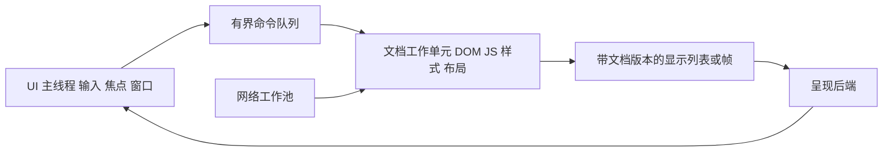

# toy-browser-py GUI 改进建议

本建议依据 2026 年 10 月 16 日第五轮实测。当前 GUI 已能完成鼠标点击、HTTP 脚本状态保持、历史导航和标签页切换，下一步应先解决操作完整性和事件循环阻塞，再做外观与 GPU 窗口迁移。

页面文字的变形、字距、字体回退和清晰度另见 [页面与字体渲染改进方案](页面与字体渲染改进方案.md)，包含当前 Arial 字样证据和详细修复步骤。工具栏换字体不能替代页面文字管线修复。

## 第一阶段 修复基本操作

| 优先项 | 当前证据 | 建议实现 | 验收 |
|---|---|---|---|
| 滚动条 | moveto 后偏移仍为 0；scroll -1 units 无变化 | 解析 moveto fraction 和 scroll count units/pages；处理方向与页长 | 拖动、箭头、PageUp/Down 均可到达正确位置 |
| 滚动条拇指 | 当前 set 使用 0 和 offset/content_height | first=offset/content_height，last=(offset+viewport_height)/content_height，夹至 0..1 | 拇指长度稳定反映可见比例，滚到底 last=1 |
| Enter/Space 激活 | 鼠标可触发，Enter 不执行 onclick | 鼠标、键盘统一调用 activate_element；按控件类型执行 click 和默认动作 | 同一按钮鼠标/Enter/Space 达到相同 DOM 结果 |
| 文字输入 | 缺少通用 KeyPress 页面绑定 | 完整编辑状态、光标、选区、删除、剪贴板、input/change；优先借原生编辑控件处理 IME | 英文、中文组合输入、粘贴、撤销和提交均可用 |
| 滚轮路由 | 事件只绑定在 viewport Frame | 在实际接收事件的显示控件或统一 bindtag 路由，累计高精度 delta | 鼠标处于页面文字、空白和控件上都能滚动 |
| 尺寸变化 | 导航固定 800×600，无 Configure 重排绑定 | 从视口实际尺寸生成 ResizeViewport 请求，合并连续 resize | 改窗口大小后换行、滚动范围和命中区域一致 |

moveto 的 fraction 按总文档长度解释，目标 offset=clamp(fraction×content_height,0,scroll_max)；不应再把 fraction 简单乘 scroll_max。协议参考 [Tk 官方 scrollbar 手册](https://web.tcl.tk/man/tcl8.7/TkCmd/scrollbar.html)。

键盘处理必须先判断焦点归属：地址栏、原生编辑器和页面分别处理，不能全局 Return 再误激活页面按钮。输入法组合期间不能把每个中间字符当最终 input。原生 Entry/Text 覆盖层可作为 Tk 版本的过渡方案，但滚动、缩放和控件样式必须同步到 DOM。

## 第二阶段 消除界面冻结

受控服务器只延迟 250ms，实际导航处理器中位仍约 1527ms；1ms Tk 定时器也延迟约 1527ms。800×600 位图转 PhotoImage 约 1209ms。改善方向如下：



Tk 控件和 PhotoImage 必须留在 UI 线程；网络 I/O 放工作池，文档树与 JS Host 由一个串行工作单元拥有。纯 Python CPU 工作在普通线程里仍会争用 GIL，应评估独立进程或后续本地扩展，不能把“加线程”当作 CPU 并行加速。

每次导航、缩放与关闭标签递增 document_id/epoch；任务结果回到 UI 时核对版本，丢弃过期帧。网络超时与逻辑取消必须明确；不要尝试强制终止 Python 工作线程。待显示帧只保留最新有效版本，避免导航或滚动产生无界队列。

保留加载、可交互、完成、失败、取消状态，提供 Stop，真实显示错误与进度。前台标签优先更新，后台标签节流。长任务期间地址栏、停止和切换标签必须仍响应。

## 第三阶段 改善呈现链

当前 `Bitmap.pixels` 是 Python 整数列表，每次 `_bitmap_to_photopix` 逐像素打包 PPM，再创建 PhotoImage。建议：

1. 统一连续像素缓冲区与 stride，避免每帧 Python 嵌套循环、临时 bytes 和重复拷贝。
2. 将截图 PNG 编码移出交互显示路径；PNG 压缩适合导出，不适合作为每帧窗口协议。
3. 复用图像对象，合并刷新请求；只更新预测脏区域或可见 tile。
4. 将滚动作为视口变换或复用已有 tile，而不是 hover、focus 都重建整页位图。
5. 后续 GPU 窗口直接 present 纹理，避免 GPU→CPU→PPM→Tk 往返。

现有 `_reapply_interaction` 仍执行全内容布局和光栅化；核心存在局部渲染 API 并不等于 GUI 已使用它。脏区域应由 DOM/布局失效计算，不应先重绘整帧再逐像素比较来发现变化。

## 外观与信息架构

建议布局为：

```text
标签栏：标题 / 加载状态 / 关闭 / 新建
导航栏：后退 前进 刷新或停止 | 地址栏 | 书签 | 菜单
内容区：随窗口伸缩的页面视口 + 正确比例的滚动条
底部：链接目标 / 加载和错误状态
可展开诊断区：Console Network DOM 与渲染计时
```

后退/前进按钮按历史栈禁用；地址栏展示最终 URL，保留用户编辑状态；加载期间刷新变停止。网络失败给可操作的重试入口，未支持功能给明确说明。诊断信息放可展开面板，页面正常使用不展示内部实现细节。

统一焦点环、字号、控件高度、工具提示和标签关闭行为。高 DPI 与页面缩放分别处理：布局使用 CSS 像素，输入坐标先转换为视口逻辑坐标，再除页面缩放并加滚动偏移；DPR 用于最终物理像素渲染。不要对已经是逻辑坐标的事件再次除 DPR。

测试矩阵建议包含 DPR 1/1.25/1.5/2、窗口尺寸改变、页面缩放、前后台标签、键盘全流程和 IME。缩放后输入命中、光标与绘制位置必须一致。

## Tk 与后续 GUI 技术路线

近期保留 Tk，先完成上述操作和线程边界修正。若采用 GPU 后端，建议另建可选 PySide6 Widgets 外壳，工具栏与标签使用 Qt 控件，中心使用 rendercanvas 的 Qt QRenderWidget。保持同一套 DocumentController，避免复制一份浏览器状态逻辑。

[rendercanvas 官方 Qt 文档](https://rendercanvas.readthedocs.io/stable/backends.html#support-for-qt) 支持嵌入 Qt 控件；其默认 bitmap 呈现并不自动保证高性能 GPU 直出。正式 GPU 路径应验证 screen 呈现，特别检查缩放、弹出控件、窗口遮挡与色彩管理。此技术栈会增加可选第三方依赖，纯标准库入口继续保留。

## 建议验收目标

以下是建议目标，不是当前已达成结果：输入和标签切换的 UI 调度 p95 小于 50ms；加载时停止操作可立即反馈；静态滚动不触发全页布局；目标机器热缓存滚动帧预算约 16.7ms，较低性能机器允许降级。三次样本不足以计算可靠 p95，应增加固定负载的事件追踪。

先验收滚动、键盘与无冻结，再验收外观和帧率。具体复现证据见 gui_usability.json 和第五轮实测报告。
