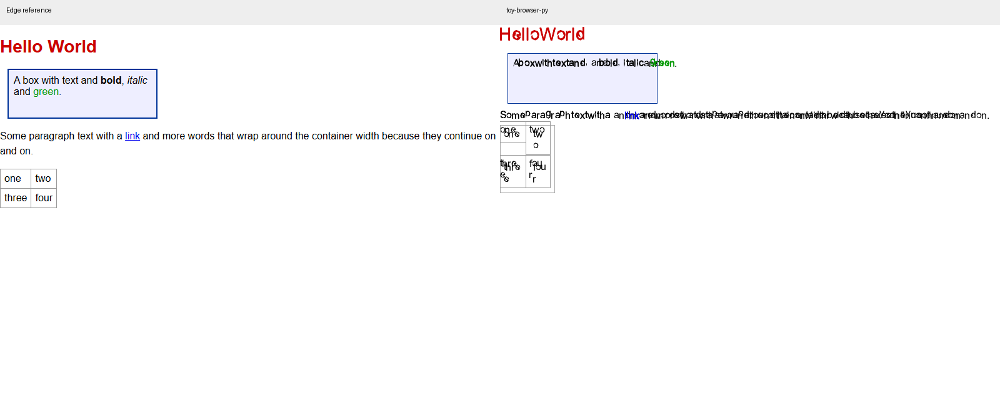

# toy-browser-py 第五轮真实浏览器实测评估

日期：2026 年 10 月 16 日。当前提交 `956220e`，参照真实 Microsoft Edge 155.0.4283.45。

**本轮修复有明显效果：此前的 HTTP 安全策略、脚本顺序、重复执行、数据脚本过滤和网络 API 最小案例均已通过。但是页面视觉与 GUI 操作仍未达到日常浏览器标准。性能瓶颈主要在布局、绘制命令构建和 GUI 图像转换，当前简单长页面不以光栅化为主要瓶颈。**

配套建议分别见 [GUI 改进建议](GUI改进建议.md) 和 [GPU 光栅化迁移方案](GPU光栅化迁移方案.md)。本次仅新增评估资料，没有修改产品源码，也没有安装 GPU 后端或声称测得 GPU 加速效果。

## 文档内容与使用方法

本节于 2026 年 10 月 16 日目录整理后补充，不改变本轮原始测试数据与结论。各轮资料按 `assessments/<轮次>/` 保存，其中 `docs/` 放报告与方案，轮次根目录放脚本、输入、JSON、截图和运行输出。下表链接可直接打开对应文档；文档中没有目录前缀的证据文件名，以所属轮次根目录为基准。

### 本轮核心文档与新增专题

| 文档 | 主要内容 | 适用场景与用法 |
|---|---|---|
| 本文：实测评估报告 | 测试范围、真实浏览器对照结果、已修复问题、剩余缺陷、性能瓶颈和证据 | 先阅读，判断当前能做什么、哪些结论有实测支撑；确定修复目标时引用具体场景、指标及对应原始数据 |
| [GUI 改进建议](GUI改进建议.md) | 滚动、键盘激活、编辑与输入法、焦点、视口变化、事件循环及界面呈现的阶段建议 | 规划 GUI 工作时使用；先处理基本操作和响应性，再安排外观与窗口后端迁移；按各项验收条件检查用户操作是否完整 |
| [GPU 光栅化迁移方案](GPU光栅化迁移方案.md) | 当前 CPU 瓶颈、可选 GPU 后端、显示列表、像素缓冲区、直接呈现、图元与文字迁移、资源与回退约束 | 进行渲染架构设计和技术选型时使用；先核对瓶颈和接口，再做小范围后端验证；其中方案与目标不代表已有 GPU 实现或已测得加速 |
| [逐项改进实施方案](逐项改进实施方案.md) | 36 个工作项：GUI 的 G01–G11、引擎与 CPU 的 C01–C10、GPU 的 P01–P13、质量与回归的 Q01–Q02；逐项列出位置、步骤、依赖、测试与交付 | 实际开发时作为任务拆分依据；先选工作项并核对依赖，再按步骤实现和验收，最后记录完成状态、测试结果及剩余限制；文中“建议新增”的文件和接口尚待实现 |
| [百度真实网页访问评估与改进步骤](百度真实网页访问评估与改进步骤.md) | 追加的百度在线测试、真实 GUI/浏览器操作、请求头诊断、JS 最小失败案例和 B01–B10 详细改进步骤 | 评估真实网站可用性与安排下一批修复时使用；与本报告固定样本结果分别解读，不能把 939 项回归通过等同于百度可用 |
| [页面与字体渲染改进方案](页面与字体渲染改进方案.md) | Arial 字样实测、轮廓/曲线/字形定位根因、字体回退、行布局、抗锯齿、DPI 与 T01–T10 实施步骤 | 处理文字变形、拥挤和小字号不清晰时使用；先修字形和排版，再提高观感与性能，样本是当前缺陷证据，不是修复效果 |

建议阅读顺序为：**本文 → GUI 或 GPU 专题建议 → 逐项实施方案 → 对应源码与回归用例**。专题建议解释方向和取舍，逐项方案落实执行步骤；对现状是否已修复，应以最新源码与重新验证的结果为准。

### 通用文档与历史资料

| 文档或入口 | 内容与使用方式 |
|---|---|
| [项目 README](../../../README.md) | 项目能力、启动方式与总览；首次运行项目时先看这里 |
| [项目结构与文件引用](../../../docs/PROJECT_STRUCTURE.md) | 当前模块目录、完整包导入、测试与评估资料位置；查找文件或处理历史路径时使用，根目录启动器与实际实现的位置以此为准 |
| [架构说明](../../../docs/ARCHITECTURE.md) | HTML、DOM、样式、布局、绘制和脚本等管线关系；修改跨模块行为前阅读 |
| [贡献指南](../../../docs/CONTRIBUTING.md) | 代码约定、测试入口、提交规范；新增实现、测试或提交变更前使用 |
| [长期路线图](../../../docs/ROADMAP.md) 与 [项目未来规划](../../../docs/项目未来规划.txt) | 长期能力目标和规划背景；用于排定后续方向，具体任务仍需结合本轮证据与实施方案确认 |
| [变更记录](../../../docs/CHANGELOG.md) | 历史阶段与已记录变更；用于追溯功能演进，不能单独证明某场景已经通过验收 |
| [全部轮次索引](../../README.md) 与 [本轮索引](../README.md) | 快速定位各轮报告和附属文档；比较进展时应选取相同输入、方法和统计口径 |
| [第四轮改进计划](../../20261016/docs/IMPROVEMENT_PLAN_R4.md) | 第四轮缺陷与分阶段修复安排；用于追溯第五轮改善的来源，不应把其中已修复问题直接当作当前待办 |
| [目录迁移验证记录](../../structure-20261016/docs/验证记录.md) | 文件重组后的回归、启动器、字体定位及链接检查，含权限受限用例重跑说明；用于确认目录迁移的影响，不替代本轮浏览器兼容性评估 |

### 从结论找到证据

| 要核对的结论 | 本轮输入与证据 |
|---|---|
| 总体结果与跨轮变化 | [summary.json](../summary.json)、[comparison.json](../comparison.json)、[functional_summary.json](../functional_summary.json) |
| JS 行为 | [js_cases.json](../js_cases.json) 为输入，对照 [Edge 结果](../edge_js_results.json) 与 [项目结果](../toy_js_results.json)；注意原始日志和去首尾空格后的比较口径不同 |
| 布局与实际绘制 | [layout_cases.json](../layout_cases.json)、[Edge 布局](../edge_layout_results.json)、[项目布局](../toy_layout_results.json)、[绘制边界](../painted_geometry.json)、[图像差异](../render_diffs.json)；结合本文截图查看，几何对齐不能代替文字和控件可读性验收 |
| HTTP 与 GUI 行为 | [Edge HTTP 结果](../edge_network_e2e.json)、[项目 HTTP 结果](../toy_network_e2e.json)、[GUI 操作检查](../gui_usability.json)、[GUI 工作流](../gui_workflow.json) |
| 性能与 GPU 条件 | [管线分段耗时](../pipeline_profile.json)、[CPU 分析](../cpu_profile.txt)、[GPU 清单](../gpu-inventory.json)；用于决定优化顺序，硬件清单不等同于 GPU 性能测试 |
| 本轮内部回归 | [测试输出](../tests-output.txt)；这是本轮评估时的结果，目录迁移后的结果另见迁移验证记录 |

### 开发与再次复测的使用流程

1. **选定问题**：从本文找出具体失败场景或瓶颈，查看原始输入与结果，再到逐项方案定位工作项和依赖。开始前核对当前源码，避免重复实现已完成内容。
2. **实施改进**：按项目结构定位实现模块，在 `tests/` 增加或调整对应回归用例，使用贡献指南约定的方式验证。纯文档调整不必重跑完整浏览器评估。
3. **先跑内部回归**：在项目根目录执行 `python test.py`；针对具体模块补充独立检查。记录环境、失败原因和重跑情况，区分产品失败与权限或依赖问题。
4. **建立新轮次**：再次做浏览器对照前，新建 `assessments/<新轮次>/`，复制所需脚本和输入，核对脚本中的历史轮次引用及输出位置。需要运行的对照浏览器与外部依赖按原评估环境准备，不直接覆盖第五轮证据。
5. **按需复测并记录**：JS 与布局可参考 `toy_js_runner.py`、`toy_layout_runner.py`，网络、GUI 和性能使用该类对应脚本；命令中的目录必须指向新轮次。核对真实浏览器输入、视口、字体、容差及统计方式后再比较结果。
6. **交付结论**：在新轮次 `docs/` 写入报告，附输入、输出和截图链接，说明哪些项已通过、哪些仍有差距，再更新该轮及全部轮次索引。只有通过验收的任务才标记完成，方案中的目标值不能当作实测值。

## 本次覆盖范围

**追加在线实测说明（2026-10-16）**：目录整理后又实际访问了百度。默认 HTTPS 在项目中得到 227 字节脚本跳转页，CLI/GUI 白屏；浏览器式 User-Agent 对照取得完整首页后又触发 JS 多声明语法错误，搜索任务未能完成。真实浏览器则可输入并展示搜索结果。详见 [百度专项报告](百度真实网页访问评估与改进步骤.md)。以下覆盖范围和数据仍为原第五轮固定测试集，不将追加结果混入原统计。

| 项目 | 方法与范围 |
|---|---|
| 内部测试 | 当前完整 `python test.py`，新增回归已收录，939 项 |
| JS 与 DOM | 与上轮相同 51 个输入，重新用 Edge 和项目执行，含异步与观察器回调 |
| 布局 | 17 个页面、48 个边框盒，1px 容差 |
| 实际绘制 | 4 个无文字色块 PNG 边界检查，另有 4 个文本与表单截图 |
| HTTP | 10 个实际页面，对照 CLI 与 GUI 的策略、脚本和请求结果 |
| GUI | tkinter 实际处理入口；滚动条 Tcl 回调、按钮 Enter、导航定时器延迟、PhotoImage 转换 |
| 性能 | 100/1000/5000 元素，每项 3 次，另分测 parse/style/layout/emit/raster/PNG 并运行 cProfile |
| 硬件 | 只读查询发现 NVIDIA GeForce RTX 3060 Ti，驱动 32.0.16.1088；未创建设备或运行 GPU 渲染基准 |

环境为 Windows 11、配套 Python 3.12.14、Node 24.21.0。页面截图 800×600、设备缩放比 1。GUI 检查由程序驱动，不冒充人工鼠标、键盘或输入法体验。未验证完整 WPT、多个浏览器内核、公开网站登录、读屏器、音视频或长期稳定性。

评估开始时已有未跟踪的 `_run_live.py` 和 `demo_out.png`，本次保留，未视作待清理产物。

## 相同样本的改善

| 指标 | 第四轮 | 本轮 |
|---|---|---|
| 内部回归 | 925/925 | 939/939 |
| 51 个 JS 原始日志相符 | 47/51 | 50/51 |
| 去日志首尾空格后相符 | 48/51 | 51/51 |
| 定时器排空异常 | 无 | 无 |
| 边框盒探针 | 48/48 在容差内 | 48/48 在容差内 |
| CLI 10 个 HTTP 任务 | 4/10 | 10/10 |
| GUI 10 个 HTTP 任务 | 3/10 | 10/10 |
| GUI 鼠标点击及历史导航 | 通过 | 继续通过 |

51 个 JS 输入中，1 个是双方都因无效 JSON 报错的输入；唯一原始日志差异仍为尾部空格。因此这些结果是有限测试集的行为对齐，不是完整 JS 标准或网站兼容率。

本轮确认修复了 MutationObserver、ResizeObserver 最小回调案例、真实 HTTP fetch/XHR、本地与 GUI 文档 CSP、nonce、普通脚本顺序、重复外部脚本及 application/json 数据块不执行。不能再沿用上轮“API 只是占位”或“GUI CSP 未生效”的结论；复杂凭据、取消、重定向策略、观察器递归等仍需独立扩展测试。

## 页面视觉仍存在明显问题

基础页仍出现文本重叠、粗体斜体行内元素远离原位置、段落空格与断行异常，以及表格单词拆行。几何 API 与实际文本可读性需要分别验收。

| 页面 | 全图差异 | 前景并集差异 |
|---|---:|---:|
| 基础排版 | 约 6.23% | 73.12% |
| 中文 | 约 3.44% | 98.41% |
| 特殊符号 | 约 0.75% | 99.58% |
| 表单 | 约 2.84% | 92.11% |

RGB 三通道绝对差总和大于 30 为差异；任一图像像素任一通道低于 240 纳入前景并集。字体、抗锯齿、位置及白背景会影响指标，不以像素比例作为兼容率。

表单全图差异比上轮增加，但前景差异减少，不能仅凭某一个指标认定改善或回退，应结合预填值、控件尺寸和文本位置逐项检查。

实际绘制边界中，反向 Flex、gap、非等宽 Grid 的联合边界对齐。含 padding/border 的红色区域：Edge 为 `(63,6,237,36)`，项目为 `(62,5,238,37)`，比上轮明显接近，但仍存在边缘覆盖差异。此处不是“48 个几何探针全部通过”的替代验证。

## GUI 发现的具体缺陷

| 操作 | 实测结果 | 影响 |
|---|---|---|
| 通过滚动条标准回调 moveto 0.5 拖动 | 偏移仍为 0，最大可滚动 1800 | 拖动无效 |
| scroll -1 units 向上滚 | 偏移 100→100 | 方向/单位回调未处理 |
| 聚焦同一按钮后 Enter 激活 | SAFE，鼠标点击则为 CLICKED | 键盘与鼠标行为不一致 |
| 正常导航到延迟 250ms 的本机小页面 | 导航处理器中位约 1527ms | 主线程同步处理网络、渲染和显示 |
| 导航前排队的 1ms Tk 定时器 | 中位约 1527ms 后才执行 | UI 事件循环被阻塞 |
| 800×600 位图转 PhotoImage | 中位约 1209ms | 每次刷新显示成本很高 |

首个定时器样本还包含 Tk 的初始化/事件处理开销，因此记录了全部 3 次原始样本，不把首个异常高值单独归因于网络。

代码和绑定检查还发现：导航仍固定传入 800×600；没有窗口 Configure 重排绑定；页面区域没有通用 KeyPress 输入绑定；滚轮绑定在 viewport Frame，显示像素的 Label 自身没有绑定。后三项属于代码与绑定证据，没有冒充完成真实 IME 或物理滚轮实测。

滚动条实现使用 movements/units 分支，而 Tk 正常传入 moveto 或 scroll 参数，因此实际回调未更新位置。Enter 路径只处理控件状态，没有复用鼠标脚本激活流程。详细修改顺序见 GUI 建议。

## 分阶段性能与 GPU 决策

分段探针和完整 API 都在完整回归结束后单独执行。各项 3 次，下面列阶段中位数；各阶段中位数相加未必等于整次样本中位数。

| 阶段 | 100 元素 | 1000 元素 | 5000 元素 |
|---|---:|---:|---:|
| HTML 解析 | 3ms | 42ms | 179ms |
| 样式 | 21ms | 186ms | 1073ms |
| 布局 | 62ms | 651ms | 3320ms |
| 构建显示列表 | 24ms | 257ms | 1339ms |
| CPU 光栅化 | 145ms | 143ms | 151ms |
| PNG 内存编码 | 577ms | 574ms | 578ms |

5000 元素代表样本从解析到位图为 6058ms，光栅化 151ms，占 **2.49%**。假设只将光栅化降为零、其余步骤不变，理论加速上限约 **1.026 倍**，即总耗时仅减少约 2.5%。这不是 GPU 实测结果，而是当前工作负载的 Amdahl 上限推算。

完整 `render_document` 的 5000 元素中位约 6382ms，含 PNG 写出约 6973ms；Edge 设置内容并强制布局约 44ms、含截图约 85ms。两端 API、绘制与编码开销不同，不据此给出严格性能倍数。分段探针还不含完整 Host 初始化等公共 API 开销，不能直接替代完整 API 的计时。

cProfile 指向 layout.build_box、样式访问与 `_emit` 的大量 Python 对象处理；PNG 行打包和 GUI PPM/PhotoImage 转换也保留逐像素 Python 工作。仅迁移 rasterize 无法解决布局、显示列表和窗口显示耗时。GPU 更适合在这些基础工作改进后，加速高 DPI、大面积填充、图像、阴影、合成和滚动。

## 改进优先级

1. 先修滚动条协议、Enter 激活、输入与焦点路由，使基本 GUI 任务完整。
2. 分离 UI 与文档工作，避免同步导航及整页重绘阻塞；替换逐像素图像转换。
3. 修行内格式化和表单绘制，以截图中的可读性为验收目标。
4. 优化 build_box、显示列表构建和缓存失效，再评估更大工作负载。
5. 将 CPU 后端保留为默认参考实现，新增可选 GPU 后端，先做正确性、呈现与帧时间验证，再迁移复杂效果。

## 证据与复现

本目录的 tests-output.txt、summary.json、functional_summary.json、comparison.json、GUI 与 HTTP JSON、截图均为本轮重新生成。额外证据包括：

- gui_usability.json：滚动条、Enter、事件循环、PhotoImage 转换。
- pipeline_profile.json：完整分阶段样本；cpu_profile.txt：热点；decision_metrics.json：代表样本与理论上限。
- gpu-inventory.json：只读显卡查询；其中 AdapterRAM 是 WMI 字段，不据此认定实际可用显存。
- 实测评估报告.md、GUI改进建议.md、GPU光栅化迁移方案.md：结论与方案。

常规回归与对照复现方法同上轮，但使用本目录路径。新增 gui_usability.py 需要本机 HTTP 回环权限；pipeline_profile.py 只运行 CPU 管线，不改写旧报告。当前已有 GPU 硬件，但尚未安装或验证所建议的 GPU 软件栈，本轮没有 GPU 性能成绩。
