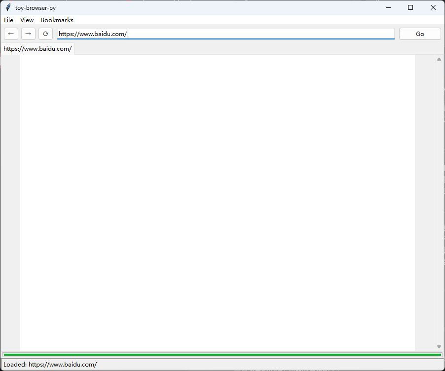
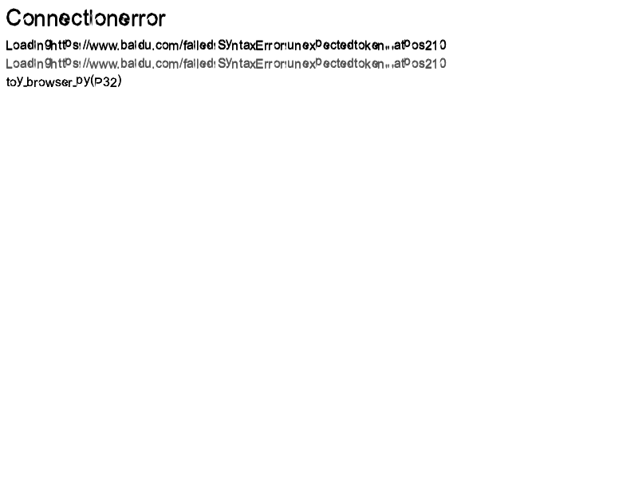
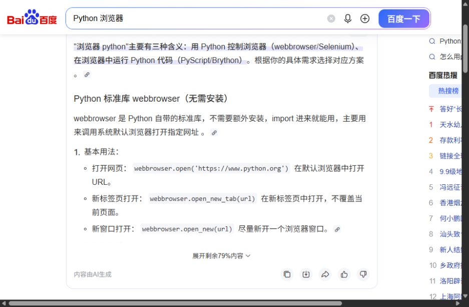

# 百度真实网页访问评估与详细改进步骤

测试日期：2026-10-16，时间以北京时间为准。本专题作为第五轮的补充在线实测，不替换原第五轮固定样本报告。本次仓库 HEAD 为 `fa910db`，已包含 `dacc194` 的目录重组及启动器变更；原第五轮固定样本基线为 `956220e`。本次没有修改产品源文件，所测模块哈希见 [环境记录](../baidu-live/environment.json)。

**结论：目前不能用本项目完成“打开百度首页 → 输入关键词 → 搜索 → 阅读结果 → 打开结果”的真实浏览任务。默认 HTTPS 请求能收到 HTTP 200，但返回的是跳转脚本页，CLI 与 GUI 生成全白页面；浏览器式 User-Agent 对照能取得完整首页，但触发项目 JS 解析异常，CLI 无法完成渲染，GUI 错误地将脚本失败归为连接失败。**

这说明此前 939 项回归及固定小样本对齐，不能推导出百度这类真实网站可用。改进顺序应为：导航与状态 → 脚本错误隔离及语法 → 输入与提交 → 资源、布局和视觉 → 响应性；GPU 不在本次阻断链的首位。

## 1. 如何使用本文

- 判断当前能否访问百度：阅读第 2–4 节，结合截图和 JSON，不把 HTTP 200 或生成 PNG 当作页面可用。
- 开发修复：按第 6 节 B01–B10 拆分任务，每项均列出位置、步骤及验收；新增模块和测试名属于建议，尚未实现。
- 再次复测：使用第 7 节流程和第 8 节证据索引，创建新的证据目录，保存变更前后结果。
- GUI 与 GPU 的长期工作仍参考 [GUI 建议](GUI改进建议.md)、[GPU 方案](GPU光栅化迁移方案.md)、[逐项实施方案](逐项改进实施方案.md)；当前文件位置以 [项目结构](../../../docs/PROJECT_STRUCTURE.md) 为准。

本文仅新增测试脚本、观测数据和改进方案，没有修复产品实现，也没有安装浏览器或 GPU 依赖。

## 2. 方法、环境与边界

| 项目 | 实际执行方式 |
|---|---|
| 目标 | `https://www.baidu.com/`；查询词为 `Python 浏览器` |
| 项目网络层 | 使用本项目 `net.HttpClient`、`net.fetch_html`，默认 TLS 配置，8 秒请求超时 |
| 项目 CLI 管线 | 调用 `browser.render_document_from_url`，800×600；记录请求和 PNG，未修改引擎 |
| 项目 GUI 管线 | 调用 `PageInstance.load_url`，800×600，保留默认子资源加载；另启动真实 tkinter 窗口，通过地址栏 Enter 实际导航 |
| 真实浏览器 | Codex 内置浏览器，在线打开首页、填入查询词、按 Enter、读取结果 DOM、点击 Python 官方文档结果；本次未采集其内核版本号 |
| 请求头对照 | 单独的 `*-ua` 诊断运行只覆盖 User-Agent；不作为项目默认能力或已经实现的兼容修复 |
| HTTP 对照 | 按实际响应中出现的 `http://www.baidu.com/` 地址直接抓取一次，用于确认跳转目标能否返回内容；未改变项目默认地址或安全配置 |
| 环境 | Windows，本机配套 Python 3.12.14；网络访问在允许外网的权限下执行 |
| 限时与样本 | 每个成组项目探针设 75 秒进程期限，本次均在期限内返回；各场景单次观测，不能据此计算稳定性或平均性能 |

真实浏览器截图为 937×613，项目位图为 800×600，页面响应内容和会话也不同，因此没有计算逐像素相似度。浏览器填写中文通过自动化文本填入完成，不能据此证明项目或参考端的中文输入法组合流程已验收。

参考端点击结果后，新标签最终 URL 和标题确认到达 Python 官方文档；该目标标签的详细 DOM 抓取两次超时，因此只确认跳转落点，不宣称完成目标页全文阅读。项目端因首页不可用，搜索框输入、搜索提交和结果点击属于**被前置问题阻断**，没有伪造完成这些操作。

## 3. 在线实测结果

### 3.1 默认配置

| 场景 | 实测结果 | 判断 |
|---|---|---|
| 默认 HTTPS 抓取首页 | HTTP 200；正文 227 字节，内容主要为 `location.replace(...)`，不是百度完整首页 | 网络连通；页面任务未完成 |
| CLI URL 渲染 | 约 267ms；生成 800×600 PNG，非白像素为 0；仅记录 1 次请求 | 渲染返回成功，但用户看到白屏 |
| GUI 页面管线 | 约 269ms；正文 227 字符；焦点链为空；位图非白像素为 0；仅 1 次请求 | 没有可操作的搜索框 |
| GUI 启动参数 | 执行 `python gui.py https://www.baidu.com/` 后显示 `about:blank` | URL 参数未用于初始导航，需另行输入地址 |
| GUI 地址栏导航 | Ctrl+L → 输入 HTTPS 地址 → Enter；地址和标签切到百度，内容仍白，状态栏显示 `Loaded` | 原生地址栏工作；页面状态误报成功 |
| 直接抓取搜索 URL | `/s?wd=Python%20%E6%B5%8F%E8%A7%88%E5%99%A8` 也返回 227 字符脚本跳转页 | 手工拼查询 URL 不能绕开默认响应问题；不等于搜索交互完成 |

227 字节首页中的关键行为是：

```javascript
location.replace(location.href.replace("https://", "http://"));
```

该内容属于网站实际响应，不能据此断定网站所有用户都会得到同一页，也不能只凭本次结果将其归因为反爬、IP、地区或 TLS 指纹。实测能确认的是：**本次请求头条件改变时，返回内容出现显著变化。**

实际 tkinter 窗口：



### 3.2 请求头与完整首页诊断

默认标识来自 `toy_browser/network/net.py`：`toy-browser-py/1.2 (P21-P23)`。诊断标识为：

```text
Mozilla/5.0 (Windows NT 10.0; Win64; x64) AppleWebKit/537.36 (KHTML, like Gecko) Chrome/155.0.0.0 Safari/537.36
```

这是为分离响应差异而设置的测试参数，不是已采集的参考浏览器真实标识，也不意味着仅改标识即可成为 Chrome。

| 场景 | 实测结果 |
|---|---|
| 默认标识、HTTP 首页抓取 | HTTP 200，解码后约 72.8 万字符，有完整 HTML 文档 |
| 浏览器式标识、HTTPS 首页抓取 | HTTP 200，解码后约 72.9 万字符，有完整 HTML 文档 |
| 浏览器式标识、GUI 完整加载 | 33 次已记录 GET 均返回 200；主文档解压后 736,804 字节；约 2.26 秒后显示 `Connection error`，详情实际为 `SyntaxError: unexpected token ',' at pos 210` |
| 浏览器式标识、CLI 完整加载 | 33 次已记录 GET 均返回 200；主文档解压后 738,015 字节；约 1.30 秒后抛出 `js._Throw`，原因是同类 JS 语法错误，未产出本次 CLI 位图 |

主文档大小随请求变化，不能把不同运行的动态 HTML 当作字节相同的输入。请求计数来自探针覆盖的 `HttpClient.get`，不等于浏览器完整网络瀑布或所有协议请求总数。上述耗时是到当前成功返回或失败的单次时间，不能解释为完整百度页面加载耗时，更不能与参考端比较加速倍数。

GUI 的诊断错误页如下。其文字挤压也提示文字布局仍有问题，但这是错误页，不是完整首页的视觉评估。



### 3.3 真实浏览器任务

| 步骤 | 观察 |
|---|---|
| 打开首页 | 标题为“百度一下，你就知道”，有 `chat-textarea` 和“百度一下”按钮 |
| 填入搜索词 | 文本框显示 `Python 浏览器` |
| 按 Enter | URL 转为百度 `/s?...wd=...`，最终标题为“Python 浏览器_百度搜索” |
| 查看结果 | DOM 可见 Python 模块浏览器文档、Python.org 等结果；截图保存了结果页中的内容区域 |
| 点击官方文档结果 | 新标签最终落到 `https://docs.python.org/zh-cn/3/library/pyclbr.html`，标题为 Python 3.15.0 文档；只验证 URL 与标题，目标页详细 DOM 抓取超时 |



参考端结果用于验证任务路径可行，不采用网页中 AI 生成内容或广告的技术陈述作为本报告的依据。

## 4. 已定位原因与尚未验证项

### 4.1 直接证据

1. **初始 URL 被忽略**：`TabBrowser.__init__` 只对 `os.path.isfile(initial_path)` 成立的参数调用加载，否则创建 `about:blank`。与真实窗口观察一致。
2. **导航宿主不完整**：`web_api.make_location` 返回包含 href 等属性的字典，没有可调用的 `replace`。当前没有把该脚本行为接到 GUI/CLI 文档导航；默认在线加载也只出现一次 GET，最终停在原 URL。这里只把“导航桥缺失”作为已确认缺口，不声称实现方法后百度一定成功。
3. **多声明语法缺口**：捕获的完整首页第一个内联脚本在 `var css='body {display: none}', head=...` 的逗号处解析失败。离线缩减确认 `var a=1,b=2;`、`let a=1,b=2;`、`const a=1,b=2;` 都失败，而 `var a=1; var b=2;` 通过；额外的 `(1,2);` 也失败。这是声明列表与序列表达式两类缺口，不能用简单分割逗号修复。
4. **脚本错误越过文档边界**：`Host.execute` 将部分 Python 解析异常包装为内部 `_Throw`，而 `execute_scripts_in_order` 的脚本边界仅捕获 `JSUncaughtError`。本次调用栈证明 `_Throw` 逃逸至 URL 渲染入口。
5. **错误分类与状态不一致**：GUI `PageInstance.load_url` 的广义异常分支构造“Connection error”页，尽管 33 个已记录 GET 均为 200；默认白屏时又没有内容可用性诊断。网页脚本失败与传输失败没有分离。

详见 [离线缩减结果](../baidu-live/page-analysis.json) 与 [CLI 调用栈](../baidu-live/cli-ua-result.json)。

### 4.2 代码审查提示的后续缺口

完整 HTML 样本解析得到 399 个元素，含 34 个 script、4 个 textarea、15 个 input、19 个 img、13 个 link。可识别 `chat-textarea`、`chat-submit-button`，同时还有 `action="/s"` 的传统 form 和名为 `wd` 的 input。

这些节点存在不等于已经可见或可操作。`_click_dispatch` 能记录 textarea 焦点，但尚缺完整编辑输入；`_activate_focused` 对 input/button 主要做 checkbox 切换，未实现统一表单默认动作；`_navigate_to` 对相对链接仍是空分支。这些属于源码核实的能力缺口，本次没有在可用百度页面上单独完成它们的交互验证。

完整首页未成功渲染，因此本次不能评价其最终 logo、搜索框、热搜区域、中文排版、图片解码、滚动与响应式布局是否正确。也未测登录、验证码、音视频或持久会话。

## 5. 优先级与依赖

| 编号 | 优先级 | 改进项 | 前置 |
|---|---|---|---|
| B01 | P0 | 初始 URL 与统一导航入口 | 无 |
| B02 | P0 | 请求配置与页面可用性诊断 | B01 |
| B03 | P0 | 脚本异常隔离及错误分类 | 无，可先做 |
| B04 | P0 | 多变量声明与序列表达式 | B03 |
| B05 | P0 | location、文档基址与真实导航 | B01、B03 |
| B06 | P0 | 文本编辑、焦点及中文输入 | B03、B04，需先能展示页面 |
| B07 | P0 | 统一激活、表单提交与链接跳转 | B01、B05、B06 |
| B08 | P1 | 资源与事件生命周期、增量可见内容 | B03、B04、B05 |
| B09 | P1 | 首屏布局、文字与错误页呈现 | B03、B08 |
| B10 | P1 | 异步加载、取消与真实任务回归 | B01，贯穿其余任务 |

## 6. 逐项详细改进步骤

### B01：让启动参数、地址栏、链接使用同一导航控制器

**位置**：`toy_browser/app/gui.py` 的 `TabBrowser.__init__`、`_navigate`、`_navigate_to`；`toy_browser/app/browser.py`。建议新增 `toy_browser/app/navigation.py`。

1. 定义导航请求对象，至少包含源文档、目标 URL、触发方式、是否替换历史、导航序号；本地文件、about 页面和 http/https 经同一分派入口处理。
2. 启动时先创建标签与显示容器，再用事件队列提交 `initial_path` 导航；不要在仅接受本地文件的条件外丢弃 URL。
3. 地址栏明确处理网址、相对 URL 和普通文本。搜索引擎地址补全作为独立产品策略，不能把所有未知输入都当本地文件。
4. 成功提交新文档时统一更新地址栏、标题、当前 URL 与历史；请求失败时保留请求目标与错误类型，避免仅改界面文本。
5. 建议增加 `tests/test_navigation.py`，覆盖启动 HTTPS、本地文件、about、重定向、前进后退及失败重试。

**验收**：`python gui.py https://www.baidu.com/` 自动产生导航，地址栏输入相同 URL 与启动参数经过同一入口；新页面失败时也有清晰状态。首页能否完成展示由后续工作验收。

### B02：把服务器响应差异做成可观察的兼容性问题

**位置**：`toy_browser/network/net.py` 的 `HttpClient`、进度事件；`toy_browser/app/gui.py`、`toy_browser/app/main.py`。

1. 以配置对象集中管理 User-Agent、Accept、Accept-Language、Cookie 策略、超时与重定向预算，文档及子资源共用，避免在多个请求函数里硬编码不一致的标识。
2. 允许显式选择兼容标识用于诊断，界面和日志记录实际选择；保持产品标识与能力声明一致，不把标识切换描述成引擎兼容修复。
3. 记录主文档状态、最终 URL、Content-Type、解码后大小、请求 ID 和导航链。区分“传输完成”“文档已提交”“首屏已绘制”“存在脚本错误”。
4. 对“200 + 极小脚本页面 + 没有可见内容”的组合提供诊断提示，不单凭正文短小判失败；空文档本身也可能是合法页面。
5. 用本地服务分别返回完整页、合法空页、脚本跳转页、错误 MIME 和 4xx，验证诊断状态。再按本次默认/兼容标识各做一次在线对照。

**验收**：能解释当前收到哪一种页面；完整页仍需交由正常引擎处理。不得以关闭证书验证或固定将 HTTPS 改成 HTTP 作为通用修复。

### B03：隔离脚本失败，保留文档和明确错误来源

**位置**：`toy_browser/scripting/js.py` 的 `_Throw`、`JSUncaughtError`、`Host.execute`、`execute_scripts_in_order`；`toy_browser/app/browser.py`、`toy_browser/app/gui.py`。

1. 区分脚本内部可捕获 throw 与跨脚本边界的未捕获异常，建立统一错误记录，包含脚本 URL/索引、错误类别、位置和导航 ID。
2. 在每个 script 元素的执行边界转换并记录未捕获解析/运行错误；单个脚本失败后继续后续独立脚本。不得在同一已抛错脚本内部从任意下一语句继续执行。
3. 保持 DOM、已成功加载的 CSS 和资源可用于渲染；仅因一个第三方或统计脚本失败时，不替换整页为网络错误页。
4. GUI 分开处理 NetworkError、PolicyError、ScriptError 和 RenderError；状态栏允许“已显示，部分脚本失败”，诊断区展示详情，CLI 返回可检查的结构化结果。
5. 增加“有效脚本 → 无效脚本 → 有效脚本”以及外部脚本失败的回归；确认前后两个脚本的执行顺序、最后 DOM、错误列表和渲染结果。

**验收**：本次 `pos 210` 错误不再冒充连接故障、不导致 CLI 非预期崩溃；单脚本故障被报告。能显示静态内容只是降级成功，不等于百度搜索功能通过。

### B04：修复本次实际触发的 JS 语法，而非先追求广泛 API 数量

**位置**：`toy_browser/scripting/js.py` 的声明解析、表达式解析、AST 和求值器；`tests/test_js.py`。新增用例建议放入 `tests/fixtures/baidu/`。

1. 从 `first-failing-inline.js` 提取最小 fixture；把本次五个缩减案例固化为 parser 回归，并与真实浏览器执行结果核对。
2. 为 var/let/const 解析声明列表，每个声明独立保存名称与初始化表达式；保持 let/const 的作用域、TDZ 与 const 赋值限制，不合并成多个错误作用域。
3. 如支持序列表达式，为其建立最低优先级的 SequenceExpression，按从左到右求值、返回最后一项；声明列表逗号、调用参数逗号和数组元素逗号各由所属语法规则消费。
4. 验证 `var a=f(1,2),b=[3,4];`、for 初始化、对象字面量、括号表达式和换行，不能通过直接切割源码逗号解决。
5. 先重新解析捕获的首个脚本，再逐个记录后续首个阻断；补充正则、压缩代码、现代语法等具体失败用例，避免“首个脚本通过”被当成整站 JS 通过。

**验收**：本次多声明 fixture 正确解析并保持求值顺序；原 JS 回归无退化；在线复测清楚记录下一个问题或完整通过结果。

### B05：实现 location 与文档 URL 的导航语义

**位置**：`toy_browser/scripting/web_api.py` 的 `make_location`、`install_globals`；`toy_browser/scripting/js.py` 的 Host；`toy_browser/app/navigation.py`（建议新增）。

1. 替换仅存属性的 location 字典，用宿主对象读取当前已提交文档 URL。核对 `host.url` 与 `host.doc_url` 的不同使用位置，统一初始化来源。
2. 支持 href 赋值、assign、replace、reload，将调用转成导航任务；禁止在 JS getter/setter 中同步递归加载整个网页。
3. 使用现有 URL 解析器处理相对目标和最终响应 URL，`replace` 替换历史项，`assign` 新建历史项；hash 同文档导航与跨文档加载分开。
4. 对 HTTP 重定向、脚本跳转和 meta refresh 共用导航次数/时间预算及取消标记；meta refresh 按解析和脚本启用状态处理，不扫描源码猜测任意脚本目的。
5. 跨协议跳转由明确的导航策略处理，显示最终协议和链路；不关闭 TLS 校验。增加循环跳转、同页 hash、替换历史及旧任务取消的本地 fixture。

**验收**：本次 227 字节脚本页不会无声地被当成完整首页；要么按已定义策略完成导航，要么清楚报告为何未导航。最终成功仍需检查可见搜索框。

### B06：让 textarea/input 真的可编辑，并正确处理焦点和 IME

**位置**：`toy_browser/app/gui.py` 的 `_click_dispatch`、焦点链、`_set_form_value`；`toy_browser/scripting/js.py` 的 DOM 属性与事件。

1. 建立字段编辑状态：value、光标、选区、组合输入区、只读和禁用状态；以稳定 DOM 身份关联，不能只依赖可能变化的遍历下标。
2. 将键盘路由分为地址栏、原生编辑层和页面。先实现文本插入、方向键、Home/End、删除、选择、复制粘贴，再接入 IME 组合事件。
3. tkinter 阶段可用 Entry/Text 编辑覆盖层，位置随滚动、缩放和视口变化同步；value 与 DOM 同步，focus/blur、beforeinput/input/change 保持一致。
4. 禁止一次输入引发全页面同步下载和重建；编辑变化触发所需事件和可合并的局部刷新。
5. 用本地 textarea/input fixture 验证英文、中文组合、混合文本、粘贴、撤销、失焦和标签切换；之后才能在可展示的百度页面操作 `chat-textarea`。

**验收**：项目内能够以真实键盘/输入法输入并编辑 `Python 浏览器`，DOM value 与显示一致；自动化直接设置 value 不能代替此项验收。

### B07：统一鼠标、Enter 与表单默认动作，完成结果跳转

**位置**：`toy_browser/app/gui.py` 的 `_activate_focused`、`_click_dispatch`、`_navigate_to`；`toy_browser/app/browser.py` 的表单相关辅助函数；DOM 和 JS 事件桥。

1. 建立 `activate_element`，鼠标、Enter/Space 按控件类型进入同一默认动作；先派发可取消事件，再决定是否执行导航或提交。
2. 实现 form owner、提交按钮、successful controls、禁用/未命名字段排除、重复字段和 UTF-8 编码；传统 GET form 用 URL 查询编码，POST 依 enctype 构建请求。
3. 将 `action="/s"`、相对 a href、协议相对 URL 和 `<base>` 都交给文档基址解析；明确处理 target=_blank、当前页、hash 以及不支持的 scheme。
4. 支持 submit/requestSubmit 与默认 Enter 提交差异；对新版百度的脚本驱动 textarea/button 仍须执行其实际事件逻辑，不能硬编码识别百度 ID 后拼接搜索 URL。
5. 用本地表单分别验证鼠标与键盘、preventDefault、中文查询、重复字段、相对路径和新标签；再验证百度结果点击到目标 URL，并检查前进后退。

**验收**：百度在原有脚本/表单逻辑下可完成搜索；结果中转 URL 能导航到目标页。直接在地址栏粘贴预先构造的搜索 URL 不算搜索表单通过。

### B08：按真实页面生命周期加载资源和调度脚本

**位置**：`toy_browser/network/net.py` 的资源加载器；`toy_browser/app/browser.py`、`toy_browser/app/gui.py`、`toy_browser/scripting/js.py`。

1. 使用同一 DocumentContext 保存最终 URL、基址、策略、Cookie、资源表、任务版本与错误列表，消除 CLI/GUI 重复拼接的状态差异。
2. 为资源记录类型、请求/解码结果、使用方和阻断原因；区分“下载 200”“成功解码”“应用到页面”。
3. 对动态插入的 script/link/img、async/defer、CSS 依赖与 DOMContentLoaded/load 建立最小一致模型；任务和微任务顺序用专门 fixture 对照，不能仅靠一次统一 flush 近似整站行为。
4. 为 font-face、图片、CSS url/import 等缺口逐项验证并按失败降级，先显示能确定的内容；保持响应大小、请求数、时间和内存预算。
5. 建立只包含本次关键加载关系的本地最小页，再对完整百度样本核对资源完成度、脚本错误列表和实际可见控件。

**验收**：能解释完整首页为何仍隐藏或缺失内容，网络成功数与页面使用结果分别可查；不得用“33 个 200”代替渲染验收。

### B09：恢复可读首屏，再评估布局和绘制性能

字体和文字部分的具体根因、样本及 T01–T10 实施细节另见 [页面与字体渲染改进方案](页面与字体渲染改进方案.md)。其中轮廓、bearing 和统一 GlyphRun 应先于抗锯齿或 GPU 优化。

**位置**：`toy_browser/style/css.py`、`toy_browser/layout/layout.py`、`toy_browser/typography/text.py`、`toy_browser/rendering/paint_engine.py`、GUI 呈现层。

1. 先保证 body 可见性、display/visibility、脚本状态变更和初始样式生效；保留隐藏态诊断，不能对百度强制覆盖所有 `display:none`。
2. 从抓取页提取搜索栏、logo、热搜、隐藏表单、固定区域等结构，拆成离线最小布局 fixture；对每种布局定位首个几何错误。
3. 优先修正中文字体回退、文本测量、空格、基线、行内排版和编辑控件；同时修正本次错误页中已可见的字形挤压问题。
4. 在统一视口、缩放、字体环境和相同静态输入下比较边框盒及截图；动态推荐/广告区域单独记录，前景差异与全图差异都不能冒充功能兼容率。
5. 等页面能操作后再采集 parse/style/layout/emit/raster/present 分段时间、至少多次样本；依据真实热点决定 CPU 或 GPU 工作顺序。

**验收**：搜索输入和按钮不被遮挡，中文能读、结果能点击，滚动后的命中位置一致；任何 GPU 接入都不改变 DOM/导航缺口的验收标准。

### B10：消除加载阻塞，建立用户任务级在线/离线回归

**位置**：`toy_browser/app/gui.py` 与建议新增导航调度模块；`tests/`、`tools/`、`assessments/`。

1. 主线程负责 Tk 与 UI 提交，网络及可隔离的文档工作由任务队列执行；每次导航携带版本号，取消/切标签后旧结果不得覆盖新页面。
2. 提供连接、下载、解析、执行、布局、绘制阶段状态和取消入口；预算耗尽与网站拒绝访问分别提示，避免持续显示 Loaded 或无响应。
3. 日常测试使用最小离线 fixture、注入 transport 和本地 HTTP 服务；公开网站在线测试独立手动/可选执行，避免把网站动态变化当作稳定单元断言。
4. 在线任务固定为“首页可用 → 输入 → Enter/按钮搜索 → 结果可读 → 结果跳转 → 返回”，逐步保存 URL、截图、DOM/可访问性、错误、请求摘要和时间；被前置问题阻断的步骤明确标为 blocked。
5. 首次修复后先完成一次闭环，再进行至少 3 次独立会话复测，并扩充相同语义的小站和本地页；记录失败分布，不以单站或单次成功声称达到真实浏览器标准。

**验收**：加载时窗口仍能响应取消与切换，错误可定位；在线与离线用例分开，单站成功有可复核的完整证据。

## 7. 建议实施批次与复测命令

| 批次 | 内容 | 退出条件 |
|---|---|---|
| A：定位与保底 | B01、B02、B03 | 初始 URL 生效；脚本错不再误报网络错；静态文档可以保留 |
| B：脚本与导航 | B04、B05、B08 的最小闭环 | 捕获脚本语法通过；location/基址可驱动导航；有可操作的首屏 |
| C：真实搜索 | B06、B07 | 中文输入、Enter/按钮、结果页与目标跳转走完 |
| D：质量与响应 | B08 剩余、B09、B10 | 可读、可取消、多次复测可复核；再决定 GPU 优先级 |

在项目根目录用同一 Python 环境运行。以下为复现入口，会覆盖 `baidu-live/` 内的同名输出，正式复测前应复制整个探针目录到新的证据目录并核对 ROOT 定位：

```powershell
python assessments/20261016-round5/baidu-live/probe.py fetch
python assessments/20261016-round5/baidu-live/probe.py cli
python assessments/20261016-round5/baidu-live/probe.py gui
python assessments/20261016-round5/baidu-live/probe.py fetch-ua
python assessments/20261016-round5/baidu-live/probe.py gui-ua
python assessments/20261016-round5/baidu-live/probe.py cli-ua
python assessments/20261016-round5/baidu-live/diagnose.py
python gui.py https://www.baidu.com/
python test.py
```

`probe.py gui` 是 GUI 文档管线的程序调用，不等同于真实窗口键盘操作；本次真实地址栏操作另有窗口截图和观察记录。`diagnose.py` 只做离线解析缩减。探针按 `outcome` 检查结果，不能只看子进程退出码：探针会把产品错误捕获后写入 JSON，进程本身仍可能以 0 退出。

本次没有重新运行全部 939 项，因为没有修改产品代码；此前目录迁移回归见 [迁移验证记录](../../structure-20261016/docs/验证记录.md)。上述修复实施后则应运行相关测试及完整回归，再做在线任务验收。

## 8. 原始证据与文件说明

| 文件 | 内容和用法 |
|---|---|
| [probe.py](../baidu-live/probe.py) | 本项目网络/CLI/GUI 管线探针，默认及浏览器式标识两类运行 |
| [diagnose.py](../baidu-live/diagnose.py) | 捕获首页的节点统计、首个失败脚本与最小语法案例；不访问外网 |
| [默认抓取结果](../baidu-live/fetch-result.json)、[原始 HTML](../baidu-live/fetch-response.html) | 核对 227 字节跳转页及返回状态；HTML 是未可信网页源材料 |
| [HTTP 对照](../baidu-live/fetch-http-result.json)、[请求头对照](../baidu-live/fetch-ua-result.json) | 比较正文差异，不把诊断请求冒充默认行为 |
| [默认 CLI](../baidu-live/cli-result.json)、[默认 GUI](../baidu-live/gui-result.json) | 管线耗时、空白位图和焦点链；对应 PNG 为 cli.png、gui.png |
| [GUI 兼容标识结果](../baidu-live/gui-ua-result.json)、[请求明细](../baidu-live/gui-ua-requests.json) | 33 个成功 GET 后仍因脚本错误显示错误页 |
| [CLI 兼容标识结果](../baidu-live/cli-ua-result.json)、[请求明细](../baidu-live/cli-ua-requests.json) | 解析错误的完整调用栈及请求记录 |
| [搜索 URL 抓取](../baidu-live/fetch-search-result.json) | 说明预拼搜索地址仍得到脚本跳转页 |
| [页面分析](../baidu-live/page-analysis.json)、[首个失败脚本](../baidu-live/first-failing-inline.js) | 多声明语法缺口的缩减依据；失败脚本属于捕获证据，不作为项目运行依赖 |
| [真实窗口观察](../baidu-live/gui-window-observation.json)、[窗口截图](../baidu-live/gui-window-https.png) | 启动参数未导航、地址栏操作、白屏 Loaded 状态 |
| [参考搜索 DOM](../baidu-live/reference-search-dom.txt)、[参考搜索记录](../baidu-live/reference-search.json) | 真实浏览器搜索已执行的页面内容和 URL，非项目生成结果 |
| [参考跳转记录](../baidu-live/reference-navigation.json) | 点击官方结果后的最终 URL、标题及目标 DOM 抓取限制 |
| [运行摘要](../baidu-live/runs.json)、[兼容标识运行摘要](../baidu-live/ua-runs.json) | 有限时保护的各子进程执行情况；需结合各 result.json 判断产品结果 |

文件名含 `*-response.html`、`*-requests.json`、`*-result.json` 分别表示该次主文档响应、GET 请求记录和管线最终结果。各次响应有独立哈希与时间；分享证据时应先检查动态会话字段，不能把抓取样本改写成产品已修复的页面。
