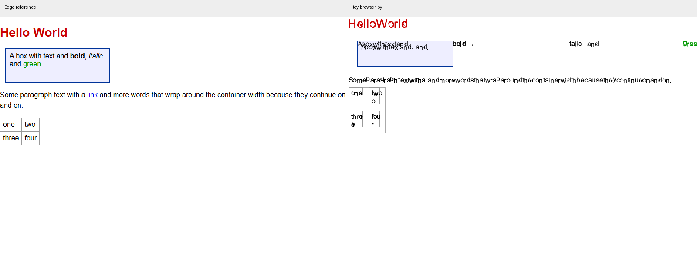

# toy-browser-py 第四轮真实浏览器标准实测评估

评估日期：2026 年 10 月 16 日。当前提交 `305163d`，参照真实 Microsoft Edge 155.0.4283.45。

**基础布局几何、JS 语义和 GUI 点击已有明显进步，但仍未达到通用浏览器的实际使用标准。** 本次 48 个边框盒探针全部在 1px 容差内；原有 47 个 JS 案例去除日志首尾空格差异后全部相符。然而，GUI 的文档 CSP 未生效，普通脚本顺序、重复执行及数据脚本类型仍有错误，真实 fetch/XHR 和观察器回调也尚未实现。

本次没有修改产品源码。评估运行器、输入、JSON、截图和完整输出均单独保存在本目录，旧报告未覆盖。

## 实测范围

| 项目 | 本次覆盖 |
|---|---|
| 环境 | Windows 11，配套 Python 3.12.14，Node 24.21.0，Edge 155.0.4283.45 |
| 内部回归 | `python test.py`，925 项 |
| JS 与 DOM | 原有 47 个案例，加 4 个 API 功能案例，共 51 个 |
| 布局 | 17 个页面、48 个边框盒矩形，1px 容差 |
| 实际绘制 | 4 个无文字色块案例，直接读取 PNG 红色区域边界 |
| 页面截图 | 基础文本、中文、特殊符号、表单，800×600、缩放比 1 |
| HTTP 页面 | 7 个原有页面，加 fetch、XHR、非 JS 数据脚本，共 10 个；同时验证 CLI 和 GUI |
| 网络基础 | 8 项重定向、循环检测、gzip、404、资源收集、缓存及策略解析检查 |
| GUI 任务 | 本地脚本、HTTP 页面脚本、点击、标签页、导航历史、17000px 长页面 |
| 性能 | 100、1000、5000 元素固定视口，每项 3 次取中位数 |

本次以可复现的本地页面为主，不代表现代公开网站覆盖率。未运行完整 WPT、多个浏览器引擎、公开网站登录、中文输入法、读屏器、音视频或长期内存压力测试。GUI 通过程序驱动实际处理入口和 tkinter 更新循环验证，未冒充人工鼠标键盘体验测试。

## 总体结果

| 维度 | 本次结果 | 解释 |
|---|---|---|
| 内部测试 | 925/925 通过 | 内部回归稳定，不能代表标准符合性 |
| 原有 47 个 JS 案例 | 原始输出 46/47 相符；去首尾空格后 47/47 | 唯一原始差异是可选链案例日志尾部空格；含 1 个双方因无效 JSON 报错的输入 |
| 全部 51 个 JS 案例 | 原始输出 47/51；去首尾空格后 48/51 | 新增 MutationObserver、ResizeObserver 和失败 fetch 行为不同 |
| 定时器排空 | 本次无 drain_error | 上轮两个函数回调异常已不再复现 |
| 几何对照 | 17/17 页面、48/48 边框盒在 1px 内 | 当前有限样本通过，不等于完整 CSS 支持 |
| 实际色块边界 | 3/4 案例的联合边界对齐 | padding/border 组合仍错误 |
| HTTP 行为 | CLI 4/10，GUI 3/10 达到所测预期 | 小型任务集结果，不是综合兼容率或安全得分 |
| 基础网络 | 8/8 检查通过 | 与 JS fetch/XHR 可用性是不同路径 |

相对上一轮，Promise 顺序、函数定时器、事件监听冒泡、动态 DOM 查询、ReferenceError、特殊数值 JSON 和 async 最小案例均有改善。GUI 点击也已把 SAFE 改为 CLICKED；HTTP 页面外部脚本修改现在能保留到显示 DOM。

## 几何已对齐 但像素仍有错误

当前运行器使用 `LayoutBox.border_rect()` 对照 Edge 的 `getBoundingClientRect()`，两端均为边框盒。本次基础块布局为 `(18,10,200,50)`，与 Edge 对齐；表格约为 70.12×61.4px，Edge 为 70.08×61px；反向 Flex、gap、单子项分配、column 及非等宽 Grid 的探针也均在容差内。

上轮报告统计的是内部 rect，含内容盒与边框盒口径差异。不能把旧 26/48 与本次 48/48 直接理解为修复了 22 个标准缺陷；本轮的口径统一与实际绘制验证都应保留。

直接读取无文字 PNG 的红色区域联合边界，格式为左、上、右、下，右下开区间：

| 页面 | Edge | 项目 | 判断 |
|---|---|---|---|
| 反向 Flex 居中 | 82,4,218,24 | 82,4,218,24 | 上轮 4px 上移已修正 |
| Flex gap | 4,4,160,24 | 4,4,160,24 | 交叉轴 margin 已改善 |
| 非等宽 Grid | 0,0,300,20 | 0,0,300,20 | 联合边界吻合，列宽由矩形探针补充验证 |
| Flex 含 padding/border | 63,6,237,36 | 67,10,229,28 | 内容绘制范围仍偏移和缩小 |

最后一项说明：即使 border_rect 对齐，绘制阶段也可能再次错误扣除边框或 padding，或者使用不同的盒坐标。应把布局矩形、背景、边框、文字和命中测试都建立在同一套几何契约上，不能只调整对外返回的矩形。

## HTTP 与脚本处理仍有阻断项

本次输入真实 HTTP 响应和页面脚本，同时读取 Edge、CLI 实际脚本 DOM、GUI 显示 DOM及颜色采样。CLI 观察器仅记录 execute_scripts_in_order 返回后的 DOM，不修改执行逻辑。

| 场景 | Edge | CLI | GUI |
|---|---|---|---|
| 普通跨源 stylesheet，无 ACAO | 绿色背景 | 绿色背景 | 绿色背景 |
| 文档 `style-src 'self'`，跨源资源带 ACAO `*` | 白色，样式被阻止 | 白色，正确阻止 | 绿色，策略未阻止 |
| 文档 `script-src 'none'` | SAFE | SAFE | EXECUTED |
| 同源外部脚本修改文字 | EXECUTED | EXECUTED | EXECUTED |
| 外部脚本后接内联脚本 | SAFE\|EXTERNAL\|INLINE | SAFE\|INLINE\|EXTERNAL | SAFE\|INLINE\|EXTERNAL |
| 同一外部脚本标签两次 | SAFE\|EXTERNAL\|EXTERNAL | SAFE\|EXTERNAL | SAFE\|EXTERNAL |
| 合法 `nonce=good` | EXECUTED | SAFE | EXECUTED |
| 真实 HTTP fetch | 200:function | 0:string | 0:string |
| 真实 HTTP XHR | 200:NETWORK_OK | SAFE | SAFE |
| `type=application/json` 的脚本数据块 | SAFE，不执行 | EXECUTED | EXECUTED |

普通跨源样式和 GUI HTTP 页面状态已经修复，应明确承认这些进展。但 GUI 的合法 nonce 案例显示 EXECUTED 不能单独证明 nonce 实现正确，因为同一入口连 script-src none 也未阻止。

### 文档 CSP 必须统一执行

GUI 从 `getattr(resp, 'content_security_policy', '')` 获取策略，当前 HttpResponse 并未提供该属性；CLI 则从响应 headers 读取。应建立统一的文档策略上下文，并让 CLI、GUI、刷新、历史返回和子资源加载使用同一结果。修复验收必须同时包含允许和禁止案例，参照 [CSP3 script-src](https://www.w3.org/TR/CSP3/#script-src)。

本次 GUI 已真正保留脚本修改，所以先前被状态丢失掩盖的策略问题现在直接可见。不能只看 CLI 策略测试通过，就声称整个浏览器策略已生效。

### 按脚本元素和类型执行

CLI 虽然已调用 execute_scripts_in_order，缓存按绝对 URL 索引，但元素仍可能用相对 src 查询。结合实测，普通外部脚本被延后到内联之后，重复标签也只执行一次。应使用文档最终 URL 和 base 解析元素 src，再按每个元素执行，下载缓存只负责复用响应。

对 `type=application/json`，浏览器应把内容当作数据块，而不是执行其中的 JavaScript。本次两端项目入口都执行了数据块中的赋值语句，需要在执行入口识别 script type、module、nomodule 和 async/defer 规则。[HTML script 元素规范](https://html.spec.whatwg.org/multipage/scripting.html#the-script-element) 明确区分脚本和非脚本数据块。

## API 类型相符不代表 API 可用

原有探针只检查 `typeof fetch`、`typeof XMLHttpRequest` 或返回值 `.then`，当前可以通过。新增行为测试则显示：

- MutationObserver 在 Edge 收到 DOM 变更回调并输出 mutated，项目仅输出 Promise 的 checkpoint，没有变更回调。
- ResizeObserver 在 Edge 对首次观察输出 resized，项目没有回调。
- queueMicrotask 的新增案例输出 sync、end、micro，两端相符。
- 对失败 fetch，Edge 不进入成功 then，项目仍进入 then，输出 Response 字段类型为 string、object。
- 本机真实 HTTP 服务正常返回时，Edge fetch 状态为 200 且 text 为 function，项目返回状态 0、text 为 string。XHR 在 Edge 触发 onload 并显示正文，项目没有完成该任务。

源码中 fetch 仍返回已兑现的模拟 Response，XHR 和两个 Observer 也保留占位行为。这些可以作为教学模拟实现，但按真实浏览器标准应标注为未完成功能。下一步应实现真实请求、Response.text()/json()、网络失败拒绝和实际观察记录，按 [Fetch 方法标准](https://fetch.spec.whatwg.org/#fetch-method) 验收。

## GUI 使用任务

以下本轮通过：

- 本地页面内联脚本把 BEFORE 改为 AFTER。
- HTTP 同源外部脚本将文字改为 EXECUTED，并保留到最终 GUI DOM。
- 命中按钮 id=b 后，实际 `_click_dispatch` 将 SAFE 改为 CLICKED，与 Edge 点击结果相符。
- 标签页数量 1→2→1；通过 TabBrowser 导航入口后退到 about:version，前进到 about:bookmarks。
- 17000px 页面内容高度为 17020px，可滚至偏移 16920px，末尾不再被旧上限截断。

仍需继续验证重排后的监听器和状态、表单输入与提交、真实键盘和中文输入法。当前程序驱动结果不能外推为完整人工体验已经通过。

## 页面视觉仍未达到基本可用标准

基础页面仍有重复和重叠文字、粗体斜体 span 横向飞出、段落空格与断行错误，表格单词被异常拆行。表单预填值、select 和按钮显示也与参照不同。基础几何修复尚未使这四个页面达到可正常阅读和使用的效果。

| 页面 | 上轮全图差异 | 本次全图差异 | 本次前景并集差异 |
|---|---:|---:|---:|
| 基础排版 | 6.26% | 6.26% | 81.12% |
| 中文 | 3.42% | 3.42% | 98.40% |
| 特殊符号 | 0.75% | 0.75% | 99.58% |
| 表单 | 2.38% | 2.38% | 99.81% |

Pillow 解码后，RGB 三通道绝对差总和大于 30 记为差异；两图任一像素任一通道低于 240 纳入前景并集。字体、抗锯齿和位移都会影响指标，大量白背景会稀释全图差异，因此这些数字不是综合兼容率。结论以截图中的实际可读性和几何边界共同判断。

## 性能与稳定性

项目计时在完整回归结束后运行，固定输出 800×600，每项 3 次取中位数：

| 元素数 | 项目到位图 | 项目含 PNG 输出 | Edge 到强制布局 | Edge 含截图 |
|---|---:|---:|---:|---:|
| 100 | 262ms | 1124ms | 6.1ms | 33.0ms |
| 1000 | 1318ms | 2209ms | 15.7ms | 48.7ms |
| 5000 | 6126ms | 7006ms | 74.9ms | 116.9ms |

两端 API、绘制、编码和进程开销不同，不计算严格倍数。本机小样本中，5000 元素仍需约 6.1 秒生成位图，PNG 另增约 0.9 秒，未达到流畅交互所需的响应速度。上轮约 5.8 秒，本轮数据不足以认定显著性能退化，应在固定负载环境扩充样本后判断。

本次正常用例与有限重复运行未发生进程崩溃，但没有验证长期负载、峰值内存、多标签资源隔离或异常资源压力，不能据此给出稳定性认证。

## 改进优先级与验收条件

| 优先级 | 改进项 | 可复现验收 |
|---|---|---|
| P0 | 统一 GUI/CLI 文档策略，从真实响应头构建 CSP | GUI 和 CLI 均阻止 script-src none 与 self 禁止的跨源样式；允许案例同时通过 |
| P0 | 统一脚本 URL、元素执行顺序、次数及类型过滤 | 相对与绝对 src 均按文档顺序；相同 src 两次执行两次；JSON 数据块不执行 |
| P1 | 修复实际行内排版和绘制盒模型 | 基础页面不再重叠、内容飞出和异常拆词；padding/border 色块边界在 1px 内 |
| P1 | 完成 CSP nonce 匹配并保持两入口一致 | 合法 nonce 允许、不匹配 nonce 拒绝，含带引号 token 和区分大小写的值 |
| P1 | 接通真实 fetch/XHR 与 Response | 本机服务状态和正文可读取；网络失败拒绝，text/json 是可调用方法；XHR 触发正确事件 |
| P1 | 实现 Observer 的实际回调 | DOM 变更生成 MutationRecord；观察元素变化和首次观察的 ResizeObserver 按预期回调 |
| P1 | 将功能行为纳入持续回归 | 保留 48 个几何探针，另加像素、HTTP 策略、真实 API 和交互任务；不以 typeof 通过代替功能完成 |
| P2 | 表单、输入法、可访问性与公开网站任务 | 完成键盘输入、Tab/Enter、提交、IME 和读屏器测试，再扩展真实网站任务集 |
| P2 | 分阶段性能与内存剖析 | 单测 style/layout/paint/编码，验证滚动与局部更新；优化依据真实耗时与峰值内存 |

建议先关闭 GUI 策略和脚本执行模型两个阻断项，再修复页面可见的排版错误与真实 API。当前应从“支持哪些名称和语法”转向“完整页面在加载、交互和网络响应后是否达到同一结果”。

## 证据与复现

本目录主要证据：

- `tests-output.txt`：925/925 完整回归；`environment.json`：Edge 与视口；`comparison.json`：源码 SHA256 和原始对照统计。
- `summary.json`、`functional_summary.json`：原始与空格规范化后的 JS 统计、API 行为、CLI/GUI HTTP 结果。
- `js_cases.json`、双方 `*_js_results.json`：51 个输入、日志和 drain_error。
- `layout_cases.json`、双方布局 JSON：48 个边框盒；`painted_geometry.json` 和 `*_geom_*.png`：实际色块边界。
- `edge_network_e2e.json`、`toy_network_e2e.json`、双方与 GUI HTTP PNG：10 个完整页面结果。GUI CSP 违规可查看 `gui_csp_inline.png`、`gui_csp_self.png`。
- `gui_workflow.json`、`edge_gui_workflow.json`、`gui_results.json`：点击、导航和滚动。
- `render_*_comparison.png`、双方页面 PNG：视觉对照；`toy_extra.json`、`edge_perf.json`：计时原始数据。

复现顺序：根目录运行 `python test.py`；运行本目录的 `extend_functional.py`，再用 Node 运行 `reference.cjs`；执行 `toy_js_runner.py`、`toy_layout_runner.py`、`toy_render_runner.py`、`probes.py`、`gui_probes.py`、`gui_workflow.py`、`network_e2e.py`、`toy_net_runner.py`。GUI 点击参照用 Node 执行 `gui_reference.cjs`；色块参照先运行 `geometry_reference.cjs`，再执行 `geometry_pixels.py`。最后执行 `summarize.py`、`compare_runs.py` 和 `functional_summary.py`。

评估工具需要 Edge、Playwright 和 Pillow；内核本身仍为标准库实现。配套运行时绝对路径需按其他机器调整。旧评估目录的部分原始文件曾随后续修复更新，本次历史比较采用上轮正式 summary 和报告，不把旧目录当作不可变的源码快照。
