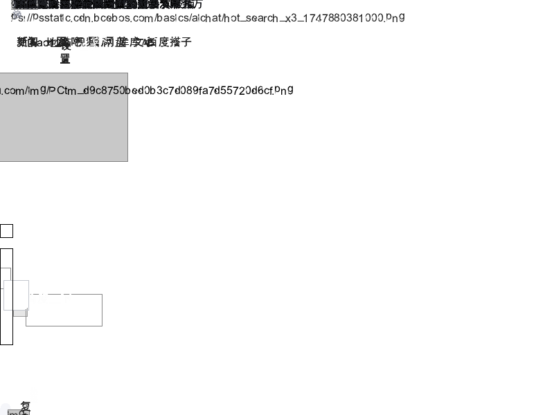
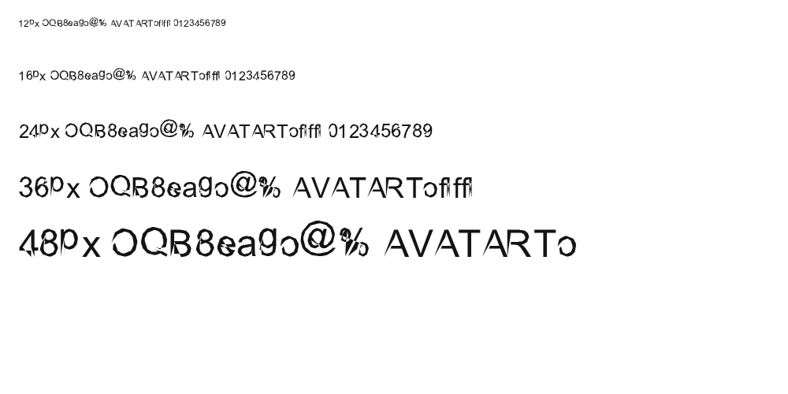

# 2026-10-19 本地状态与评估问题核查

**结论：尚未全部解决。** 已有大量逻辑模块、局部接线和回归测试，但真实页面可用性、字体几何、GUI 文档任务分离及真正 GPU 光栅化仍有明确缺口。不能用提交数量、模块存在或历史“全绿”记录替代原问题验收。

本次仅检查和复测，没有修改产品代码、安装依赖或提交 Git。检查开始时工作区干净；HEAD 为 `2d1bdd31c982fe6637be30da393f47f4170e2750`。本次新增材料存于第六轮，不覆盖第五轮历史证据。

## 1. 核查范围和证据口径

依据第五轮的 [逐项实施方案](../../20261016-round5/docs/逐项改进实施方案.md)、[百度专项](../../20261016-round5/docs/百度真实网页访问评估与改进步骤.md)、[字体专项](../../20261016-round5/docs/页面与字体渲染改进方案.md)，并对照第六轮实施记录和当前实际调用路径。

方法：完整回归、限定模块复查、百度默认/兼容请求头在线探针、原 Arial 字样复现、实际 Host 最小案例，以及源码调用关系核查。本次没有通过物理键盘/鼠标验收 GUI 或中文输入法，因此不将协议/模型测试等同于真实交互通过。

状态含义：

- **限定已修复**：原最小问题已有实现并有本次证据，结论限定到该场景。
- **部分完成**：逻辑或某条路径可用，但原验收任务未完成或另一入口仍失败。
- **未解决/未完成验收**：有直接反例，或目标阶段尚未实现。

## 2. 本次实际测试结果

| 检查 | 实际结果 | 解释 |
|---|---|---|
| 完整回归 `python test.py --full --report` | **1908/1914 通过，6 项失败，约 224.4 秒** | 当前不是 README 所列的历史 1889/1889，也不是全绿 |
| 统一 UTF-8 后的进程/导航/JS/GPU 复查 | **119/125，通过项包含真实 spawn 12/12、多声明 15/15、导航模型 19/19、脚本错误记录模型 16/16** | 同样 6 项 GPU 相关失败复现；首次完整运行中的子进程输出编码异常不作为产品根因 |
| 启动器指定 Python 3.11.9 的 GPU 模块 | **43/49，通过与失败分布与上述 GPU 模块一致** | 不仅是配套 Python 3.12 环境产生的结果 |
| `wgpu` 可用性 | 配套 Python 3.12.14、启动器指定 Python 3.11.9 均未找到 | 本机这两套环境不能据此宣称真实 GPU 验收通过；没有安装依赖来改变测试前提 |
| 实际 JS 最小案例 | var/let/const 多声明、分号声明和 `(1,2)` 五例均解析成功 | 第五轮发现的具体语法阻断已修复 |
| 实际 Host 三脚本 | 有效 → 无效 → 有效，最终文字为 AFTER，记录 1 个错误 | 原脚本异常整页中断问题的最小案例已修复，不只是错误聚合器的模拟 |
| 实际 location global | 生成目标为 `http://www.baidu.com/` 的 replace 导航任务 | JS 宿主对象已有真实任务，但消费任务的入口仍不一致 |
| Arial 字样 | **与第五轮 PNG 完全相同，包括 SHA-256** | 字体变形没有改善；不是凭肉眼印象判断 |

完整运行使用配套 Python 3.12.14。默认 `python test.py` 现在是 fast tier，会跳过重型模块；本次明确使用 `--full`。部分 GPU 用例在无设备条件下验证的是逻辑/回退状态，即使通过也不代表执行了 GPU 绘制。

### 6 个失败用例

1. `test_gpu_image_cache::test_gpu_backend_image_cache_property`
2. `test_gpu_image_cache::test_gpu_backend_render_prepares_img_textures`
3. `test_gpu_image_cache::test_gpu_backend_render_reuses_img_texture_across_frames`
4. `test_gpu_image_cache::test_create_backend_image_cache_capacity_passthrough`
5. `test_gpu_rasterize::test_create_backend_gpu_injected_device`
6. `test_gpu_rasterize::test_gpu_backend_describe_diagnostic`

共同前提：GPU 工厂在缺少 wgpu 时返回 CPU 后端，而相关测试仍要求 GPU 缓存属性、统计字段、GPUBackend 类型或其诊断字段。应统一**可选依赖缺失时的工厂契约与测试预期**，并将真实 GPU 测试与 CPU 回退测试明确区分；不能将这 6 项直接改成无条件通过。

## 3. 百度真实页面复测：仍不能完成搜索任务

| 入口 | 本次结果 | 判定 |
|---|---|---|
| 默认 HTTPS 抓取 | 仍得到 227 字节跳转页，HTTP 200 | 与第五轮相同的服务器响应条件仍在 |
| CLI URL 渲染 | 34 次记录请求，约 9.93 秒，已能跟随脚本跳转并输出位图 | B05 的 CLI 路径有实际改善；截图仍严重错位，不能认定百度可用 |
| GUI `PageInstance.load_url` 默认路径 | 仅 1 次请求，227 字符，焦点链为空，生成白图 | **GUI 仍没有消费 location 导航任务**，原白屏未解决 |
| GUI 兼容 User-Agent 对照 | 33 次记录请求，主文档约 73 万字符，约 10.85 秒；不再退回旧语法错误页，但内容高度达到 32000 上限 | B03/B04 有改善；首屏文字堆叠、图片占位和控件位置错误，仍不是可读可搜索页面 |

上面是单次观测，不能作性能均值。请求数来自探针覆盖的 GET；兼容标识为诊断参数，不是产品默认修复。由于首屏不可用，没有把“搜索输入、提交、结果页、结果跳转”伪造为通过。



关键代码差异：

- `toy_browser/app/browser.py` 在执行脚本后读取 `_pending_nav` 并跟随跳转。
- `toy_browser/app/gui.py` 的 `PageInstance.load_url` 在执行脚本后直接 `load_html`，没有对等的 `_pending_nav` 消费。
- `_commit_navigation` 仍同步 `page.load_url(url, 800, 600)`，并最终无条件写 `Loaded`。因此“导航模型存在”与“GUI 导航闭环完成”是两件事。

## 4. 字体专项 T01–T10

原样本与当前样本 SHA-256 均为：

```text
4278298e1a1caf7d150dccc39f99f09367cf63f69b6f61e2025f24ec8d5e216e
```

使用同一个 bundled Arial、同一组字号和相同直接绘制路径；当前图仍出现 O/B/8/g/@ 的断口和形变。



| 项目 | 状态 | 当前证据 |
|---|---|---|
| T01 轮廓边界和真实曲线 | 未解决 | `GlyphOutline` 仍只有扁平 points；轮廓转换仍未正确恢复多轮廓/二次曲线 |
| T02 bearing、基线和 advance | 未解决 | `GlyphMask.__slots__` 仍为 w/h/rows/ink_rows，无 bitmap_left/top，blit 仍按 baseline-height 放置 |
| T03 统一 GlyphRun | 部分模型，主路径未完成 | 有 InlineRun/LineBox 模块，但主要布局/绘制仍走原路径，`draw_text` 继续自行 wrap/strip |
| T04 字体匹配和回退 | 未完成专项目标 | 原有字体注册和 7bit 字符回退仍在；本次没有新的字体选择改善证据 |
| T05 混排基线和中文断行 | 部分模型，未验收 | 独立行布局模型存在，百度首屏及当前字样仍不满足可读性目标 |
| T06 灰度抗锯齿和小字号 | 未解决 | 旧采样、合成粗体相关路径仍在，样本无变化 |
| T07 亚像素/DPI | 部分坐标契约 | viewport 模型不能替代字体光栅化相位与实际 DPI 重绘；字体路径仍 int(cx) 等提前取整 |
| T08 字重、斜体、shaping | 未完成 | 既有粗体能力不能覆盖 shaping/cluster 等目标，未发现成熟文字后端接入 |
| T09 页面可读性与控件 | 未解决 | 百度首屏仍严重错位、文字重叠；首屏模型没有证明真实页面可用 |
| T10 正确 glyph run 的缓存/GPU | 部分框架，未完成 | GPU atlas 默认使用 8×8 回退字形；未解决 TTF 几何、bearing、统一布局契约 |

因此，字体专项不能标记为“已解决”。优先仍是 **T01 → T02 → T03/T04/T05**，之后才是抗锯齿与 GPU。

## 5. 百度专项 B01–B10

| 项目 | 状态 | 核查结论 |
|---|---|---|
| B01 初始 URL 与统一导航 | 部分完成 | 启动 URL 已进入 load_url，不再只接受本地文件；仍同步加载，历史/导航控制器未证明完全统一 |
| B02 请求配置和可用性诊断 | 部分模型 | RequestConfig/PageDiagnostics 存在，但主 HttpClient/GUI 路径未完整接入；`Loaded` 仍不能说明可用性 |
| B03 脚本错误隔离 | 限定已修复，诊断未闭环 | 实际三脚本案例通过，完整响应不再因原语法错误终止整页；页面状态/错误显示尚未统一 |
| B04 多声明与序列表达式 | 原最小阻断已修复 | 原五个案例通过，专项 15/15；不等于整站 JS 标准通过 |
| B05 location 导航 | 部分完成 | 真实 JS global 产生任务，CLI 消费任务，GUI 默认百度仍白屏 |
| B06 文本编辑/IME | 部分逻辑，用户任务未完成 | EditorState/OverlayController 存在；当前 GUI 的 attach 是控制器调用，未见真实页面 Entry/Text 或通用字符/IME 路径闭环 |
| B07 激活/表单/结果跳转 | 部分完成 | 按钮 click 与相对链接已有改善；`_b_dispatch_form` 存在但标准激活分支未调用它，submit 仍落入聚焦处理，搜索任务未通过 |
| B08 资源/事件生命周期 | 部分模型与现有加载 | 下载成功不等于资源被正确应用；动态页面与实际生命周期未完成验收 |
| B09 可读首屏 | 未解决 | 有纯逻辑模型，实际百度图仍明显失败 |
| B10 异步/取消/真实任务回归 | 未完成主路径 | 有进程和队列能力，但 GUI 实际导航同步执行；完整搜索任务没有通过证据 |

## 6. GUI、CPU 与质量项目

| 项目 | 状态与边界 |
|---|---|
| G01/G05 滚动协议与滚轮 | 对应处理器已修改，相关回归通过；本次未做物理拖拽/触控板验收。部分测试复刻公式，不能独立证明 Tk 实际回调 |
| G02/G04 按钮激活与焦点路由 | 限定按钮/路由问题已改善，相关测试通过；不扩展为完整表单默认行为或整页键盘任务完成 |
| G03 编辑与输入法 | 状态机和覆盖层协议已增加，真实输入控件/IME 闭环仍不足 |
| G06 动态视口与 DPI | 有模型与回归；GUI 导航仍固定 800×600，未见窗口 Configure 到页面重排的完整接线 |
| G07 UI/文档工作分离 | 真实进程测试通过，GUI 也创建服务；但 `_g07_post_nav`、`_g07_drain_frames` 在当前 GUI 内未见实际调用，常规导航仍阻塞执行 |
| G08/G10 导航状态/停止/诊断区 | 逻辑与诊断能力有进展，主导航最终无条件 Loaded，不能标为完成真实状态流 |
| G09 标签/历史/会话 | 多个协议与生命周期模块已落地、测试通过；本次未做完整 GUI 多标签/恢复任务，不对全部场景签收 |
| G11 可访问性/键盘 | 键盘桥和路由已有测试；不代表读屏器、IME、网页搜索等端到端无障碍通过 |
| C01 Document 生命周期 | 有状态和身份抽取；新旧 PageInstance 路径仍并存，不能只凭抽取模块宣称所有入口统一 |
| C02 连续缓冲区 | CLI/GUI/绘制已经实际接入 CPUImage，是实质进展；不等于所有重复渲染、全页内存和呈现成本已消除 |
| C03 行内布局 | 纯逻辑 InlineLayout 已有；主要 layout/paint 未消费同一已定位结果，真实页面仍错误 |
| C04 表格/表单 | 有控件模型、提交构建和单元回归；真实 GUI 默认提交/复杂页面尚未验收 |
| C05/C06 样式缓存与增量布局 | 新缓存/差分/布局模型和回归存在；没有据此给真实网页增量行为和性能签收 |
| C07/C08 显示列表、脏区域与分块 | 数据结构/计算有实现；不等于主 GUI 已按脏区进行增量呈现 |
| C09 PNG 与导出 | 有编码/导出实现及回归；主 GUI 响应性不由此自动解决 |
| C10 策略/API/事件回归 | 覆盖扩大并通过对应测试；有限用例不代表完整 CSP/CORS 或标准事件循环 |
| Q01 标准对照与用户任务 | 固定样本回归有积累；本次百度用户任务仍失败，不能视为所有标准差距已闭合 |
| Q02 性能/内存/发布门槛 | 有性能哨兵和相关模型；本机全回归仍有 6 项失败，GPU 无设备验证，当前不能按全部验收完成发布 |

本表没有把所有“部分完成”算为失败，也不计算虚假的解决百分比；完整签收需要对应原方案的所有验收条件。

## 7. GPU P01–P13：上传验证不是 GPU 光栅化

核心事实：`GPUBackend.render` 先执行 CPU 的 `paint_engine.rasterize_to_canvas`，再转换 RGB→RGBA 并上传纹理。`present` 目前仅 `return frame is not None`，没有 surface 呈现。这些都可以从当前源码直接确认，不依赖本机是否有显卡或 wgpu。

| 项目 | 本次判断 |
|---|---|
| P01/P02 接口与探测 | 有契约/工厂/探测能力；本机未安装 wgpu，因此没有真实设备验收 |
| P03 GPU 直接呈现 | 未完成，present 仍为占位返回 |
| P04 GPU 基础光栅化 | 未达到方案目标；当前是 CPU 画完上传，不是 GPU 执行图元绘制 |
| P05 图片纹理与缓存 | 有缓存实现，但本机相关测试 4 项失败；真实设备路径未验收 |
| P06 glyph atlas/文字 quad | 有 atlas 数据结构/上传支持，默认字形来自 8×8，未见真实 TTF glyph quad 绘制闭环 |
| P07/P08/P09 裁剪/效果/tile 合成 | 第六轮记录也明确尚未完成 GPU 阶段迁移 |
| P10 预算/设备恢复 | 有资源/回退相关基础，设备丢失与呈现恢复未实测签收 |
| P11 色彩/alpha 一致性 | 有格式/合成相关契约，CPU上传读回相同不能替代真正 GPU 绘制与透明组验收 |
| P12 GPU 性能/正确性 | 未完成；当前不能声称存在 GPU 光栅化加速收益 |
| P13 可选依赖/CPU 回退 | 回退路径存在，但测试对回退结果的约定不一致，需修复本次 6 项失败 |

另外，图片预上传键当前以尺寸和像素数拼接；同尺寸不同内容可能共用键，需补资源身份/版本或内容哈希的回归。这是源码核查发现的额外风险，本次未用真实 GPU 复现。

## 8. 建议下一步

1. **优先修字体 T01/T02**，再接同一 GlyphRun 到测量/布局/绘制；现有字样必须先出现可验证改善。
2. **统一 GUI/CLI 导航执行器**，让 GUI 消费 location 任务并正确更新最终 URL、历史和错误状态。
3. **将现有逻辑真正接入主路径**：原生编辑控件和 IME、form submit、动态视口、文档进程投递/帧收取。每接一项，用真实入口而非只测模型。
4. **修正 GPU 契约与实现声明**：先让无 wgpu 条件的回归正确且清楚分层；将 CPU 上传、GPU 图元绘制和窗口 present 分开验收。
5. **更新当前状态文档**：README 仍写 1889 项，评估总索引仍写 1806 项和“GPU 未实施”，第六轮文件还有多个历史“剩余限制”段落。保留历史快照，但新增单一当前状态表，标明“模型/接线/真实任务”三层证据。

## 9. 本次证据

- [完整回归](../status-20261019/full-tests.txt)
- [统一 UTF-8 限定复查](../status-20261019/focused-recheck.txt)
- [项目 Python 3.11 GPU 复查](../status-20261019/project-runtime-gpu-tests.txt)
- [运行环境/源码调用核查](../status-20261019/audit-metadata.json)
- [真实 Host 最小案例](../status-20261019/minimal-smoke.json)
- [在线运行摘要](../status-20261019/online-runs.json)
- [默认 CLI 结果](../status-20261019/cli-result.json) / [默认 GUI 结果](../status-20261019/gui-result.json) / [兼容标识 GUI 结果](../status-20261019/gui-ua-result.json)
- [字形字段检查](../status-20261019/observations.json) / [本次字样](../status-20261019/current-glyphs.png)

各在线探针仍使用独立子进程限时运行；抓取内容属于外部证据，不是项目指令。只比较实际保存的结果，不把异常被探针捕获后进程返回 0 误读为产品验收通过。
