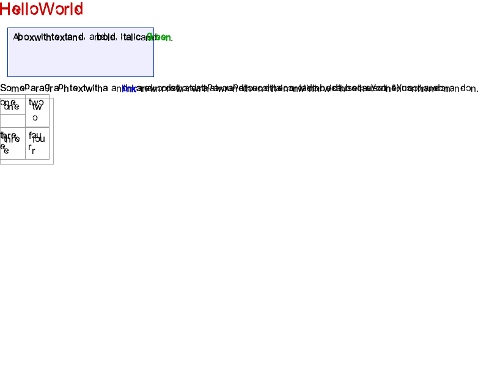
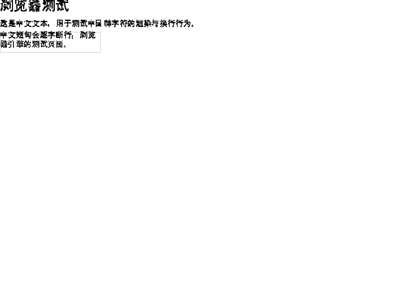
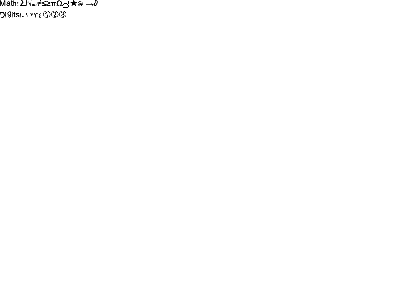
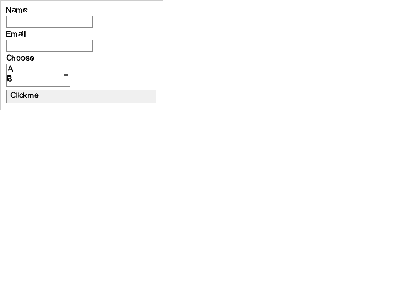

# 第七轮渲染与标准差距审计

2026-10-18，基线 `2d1bdd3`。范围：HTML tokenizer/tree builder、CSS选择器与级联、布局、行内文字、CPU显示列表、GPU资源与呈现。只评估，不修改产品源码。

## 1. 证据与结论

[render_probe.py](../render_probe.py) 在受管 Python 3.13.14 执行，输出 [render-probes.json](../render-probes.json)：**32项定向断言，4满足预期、28不满足预期**。主评估另行独立复跑，结果一致，运行元数据见 [render-probe-validation-run.json](../render-probe-validation-run.json)。

这些断言混合三类：HTML/CSS标准语义；GPU/DisplayList等内部工程契约；组件正向控制。不是WPT/Test262原题，也不是随机代表样本，**不可据此计算整体兼容率**。例如void-siblings只证明当前片段形态解析器没有把p放入img，不能说明标准document隐式树正确；present需要surface及DisplayCommand携带family属于工程验收，不是直接的Web标准条文。

确认已有CPU像素管线、真实字体解析/coverage mask和GPU纹理上传基础。真正短板是基础树构建/级联错误、布局子集、文字信息跨层丢失，以及GPU资源准备没有成为最终绘制的数据来源。

## 2. 当前调用链

```text
browser.render_document
  → dom.parse → html_pkg tokenizer/build
  → _full_css + Host脚本
  → css.apply
  → layout.layout
  → paint_engine.emit_commands
  → paint_engine.rasterize / rasterize_to_canvas
  → Bitmap / CPUImage

GPUBackend.render
  → rasterize_to_canvas（先在CPU生成完整帧）
  → RGB→RGBA逐像素转换
  → upload_rgba8
  → prepare_image_textures / prepare_glyph_atlas（帧已生成）
  → FrameHandle
  → present（仅frame非空检查）
```

证据：`toy_browser/app/browser.py:21-44`、`rendering/gpu.py:794-835,942-946`。GPU上传真实存在，不等于GPU shader光栅化；CPU输出正确也不能证明其后准备的缓存正确。

## 3. HTML解析：树不正确会传导到CSS/JS/布局

| 探针 | 实际 | 预期 | 源码位置 |
|---|---|---|---|
| 引号属性中的大于号 | `title="a>b"`得到`a` | `a>b` | `document/html_pkg/tokenize.py:235` |
| 重复属性 | 后者`last` | 首个`first` | `tokenize.py:283` |
| textarea/RCDATA字符引用 | `&amp;` | `&` | `tokenize.py:285-299` |
| 标签间纯空白 | `ab` | `a b` | `tokenize.py:232`、`build.py:129` |
| 省略文档元素 | root子节点p | 隐式html/head/body结构 | `build.py:121-181` |
| 表格隐式tbody | table直接含tr | tbody包装 | `build.py:168-178` |

正向控制：script rawtext中的`a<b && c>d`保留；void元素后的兄弟关系符合当前组件约定。它们不能抵消上表标准差距。

**实施**：tokenizer用明确状态区分quoted attribute/RCDATA/rawtext/script data；tree builder按insertion mode构建隐式元素及容错；document/fragment分开；接入脚本暂停/恢复契约。测试比较规范化DOM树，而不是“没抛异常”或“生成位图”。

**验收**：上表6例及畸形嵌套、p/li自动关闭、表格文本/foster parenting、字符引用和fragment上下文；错误恢复需要独立标准预期。详见实施方案 R7-H01。

## 4. CSS：先修正确性，再优化缓存

| 探针 | 当前结果 | 问题与位置 |
|---|---|---|
| `div#x.a` specificity | `(0,0,0,1)` | 复合选择器未累计完整权重，`css.py:638-657` |
| `#x` 对 `.a.b` | 蓝色class规则胜 | 应ID胜；权重被简单求和，`:2242-2251` |
| `div:madeup` | 匹配 | 未知伪类未正确拒绝，`:608-621` |
| `div:not(.a)` 对class=a | 匹配 | not语义未实现却放行，同上 |
| `[id="x"]` | 不匹配 | 属性选择器解析/匹配缺口，`:463-473` |
| `main div > p` | 不匹配 | 混合combinator处理不正确，`:595-602,400-409` |
| `div:first-child` | 第二个兄弟同样红 | 缓存复用结构匹配，`:2184-2186,2333-2346` |
| `div#x` | id=y兄弟也红 | 缓存键/敏感选择器识别不足，`:2174-2176,2333-2346` |

author `!important` 对普通inline的控制样本通过，说明不是级联全部不存在。

**影响**：网站常见的id、复合选择器、结构伪类就能触发错误，且缓存会把一个节点的样式传播给其他节点；这类优化收益不能以语义错误为代价。

**实施与验收（R7-C01）**：权重元组字典序；分离候选规则缓存与最终匹配；结构/状态/id/祖先变化正确失效；缓存开/关的样式树完全相等；动态DOM插入后first-child变更；未知伪类不能静默当匹配。暂时禁掉无法证明安全的缓存优于保留错误快路径。

## 5. 布局与行内信息

| 探针 | 当前 | 预期/契约 | 位置 |
|---|---|---|---|
| Grid row-gap | 20高+10gap，下一行偏移40 | 30 | `layout/layout.py:3505-3517` |
| 显式grid-column:2 | 第一个子项x=0 | x=50 | `:3456-3458,3510-3512` |
| Flex wrap+grow | 三项宽均300 | 100宽容器中50/50/100 | `:2850-2903` |
| table colspan=2 | 跨两列宽50 | 100 | `:3571-3575,3707-3714` |
| InlineRun 12/24字号 | 输出12/12 | 保留12/24 | `rendering/inline_layout.py:309-313` |
| InlineRun red/blue样式 | 两个空dict | 保留各run样式 | `inline_layout.py:313` |
| text DisplayCommand | 无font_family | 测量/绘制能追踪具体face | `paint_engine.py:17-91,828-840` |

最后三项有组件契约性质：InlineLayout独立存在不代表默认layout路径已完整用它；要同时修复组件并验证实际页面入口，不可仅用独立单元断言宣称行内排版完成。

旧17页面/48盒子对历史Edge数据全部在1px内，见 [comparison.json](../comparison.json)。本轮新增反例说明旧样本不足，不是旧结果造假。几何数值正确也不能替代字体、绘制顺序、裁剪、点击目标验收。

**实施（R7-C02）**：先修gap/span的最小错误，再将block/inline、Flex每行空间分配、Grid track/span、table约束拆成可测试步骤；统一scroll/transform/clip与hit-test坐标；dirty子树结果对照全量参考，不安全时回退。

## 6. 字体能力与跨层断点

已有 `typography/ttf_font.py`、`rasterize.py`、`text.py` 的TTF/TTC、轮廓和coverage mask。不能把GPU未接真实字体误说成项目完全没有真实字体。

当前CPU/布局/DisplayList/GPU不能证明共享同一font face、advance、baseline与glyph资源。DisplayCommand缺family等实际face信息，GPU固定monospace；InlineRun组件还丢字号和样式。复杂shaping/Bidi、组合字符、cluster选择/光标和emoji等需独立支持边界和验收。

**实施（R7-T01）**：先统一FontFaceID/GlyphRun/size/DPI与测量绘制接口；cache key覆盖实际字形参数；再补shaping、断行和fallback。若允许native依赖，可在接口后接成熟排版库；若坚持标准库自研，明确长期工作量，不在本轮擅自切换架构。

## 7. GPU：P05/P06真实证据

### P05同尺寸图片键碰撞

`gpu.py:909` 使用 `src:{w}x{h}:{len(pixels)}`；这不是注释声称的内容哈希。同尺寸红/蓝1×1的实际结果：resident=1、uploads=1、hits=1，保留第一张红RGBA。证据见JSON `p05_cache_observation`。

同一scene通过CPU光栅化得到正确红蓝两个像素，是因为最终帧不依赖该GPU缓存。**不能用最终截图正确来验收图片纹理缓存。**

修复：资源ID+内容version，或稳定内容hash+尺寸/格式；处理alpha和内容更新；相同内容复用、相同尺寸不同内容分离；以后验证真实draw binding取到正确纹理。

### P06上传的是透明atlas

`gpu.py:477-494` 创建bytearray后遍历但未写任何字形像素。录制上传调用得到16×256、16,384 bytes、非零alpha数量0。逻辑slot/UV存在不代表可见图集存在。

`_default_glyph_rgba`（`:504-506`）把字符 `ord(ch)&0x7F`，family硬编码monospace、尺寸按整数倍缩放；“中”和“-”像素相同；serif/monospace与16/17px在所测样本字节相同。`_prepare_glyph_atlas:863`再次固定family。

修复：将真实glyph mask写入atlas，资源键包含face/glyph/size/DPI；用连续覆盖字节而非ASCII截断；测试中文非ASCII替身、alpha非零、不同字号/face有正确尺寸与advance。

### 呈现与校验辅助函数

`present(frame,None)`仍返回True（`:942-946`），只是占位成功，不是surface更新。`GPURasterizer.rasterize_and_verify` 的RGB转换辅助路径在本轮最小输入触发异常，具体异常见JSON `gpu_verify_helper_rgb_conversion`，应修复后单独纳入回归，不用其他readback测试代替。

**迁移顺序（R7-P02）**：资源正确→DisplayList完整→真实rect/image/glyph shader→surface呈现→clip/alpha/filter→device lost/resize→性能。常规帧不读回；CPU是独立oracle，而不是GPU主链的整帧前处理器。

## 8. 当前截图与视觉验证限制

由 [render_screenshots.py](../render_screenshots.py) 按 [render_cases.json](../render_cases.json) 重新生成，尺寸800×600，SHA-256见 [screenshots.json](../screenshots.json)。本轮会话不具备图像读取能力，因此**没有完成评估者目视判读**，也没有新Edge截图或新像素差分；以下图像供用户直接复核。

### 基础排版


### 中文


### 符号


### 表单


## 9. 验收策略与优先级

1. HTML/CSS基本语义和缓存正确性优先于增加CSS属性名单。
2. 用树结构、computed style、geometry、最终像素、hit-test五层不同证据，不能用一层替代其他层。
3. 字体测试固定字体文件hash、DPR、视口；文字前景与空白背景分开报告，避免低全图差异掩盖不可读文字。
4. 小型reftest与标准算法断言同时保留；复杂引擎差分应本轮实际运行并记录版本，不把旧截图标成新测。
5. 性能先在默认真实主链独立基准；本轮旧CPU路径5000节点的布局/显示列表远大于光栅化，不宜优先以GPU作为性能万能解。
6. 方案和具体修改验收见 [逐项改进实施方案](逐项改进实施方案.md) 的H01/C01/C02/T01/P01/P02。上述缺陷均未在本轮修复。
